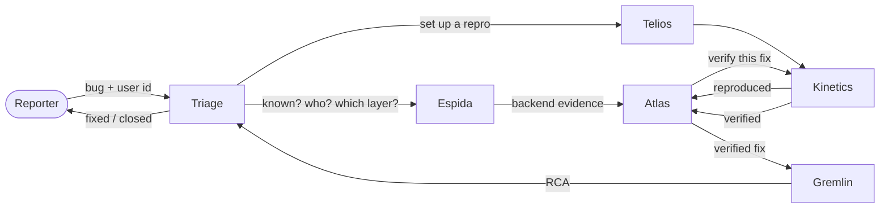

# TraceSquad

**A squad of six AI agents that takes an app bug from a one-line report in a chat channel to a verified
fix and a root-cause write-up, working like a team: they ask each other questions, with no coordinator
and no fixed pipeline.**

> **AI agents:** if you've been asked to set this squad up, read [AGENTS.md](AGENTS.md). It has the
> recipe for Switch, Claude Code and any other agent platform. The structure is in [squad.yaml](squad.yaml).

## The problem

When a user reports a bug in a support channel, most of the work of fixing it is coordination:

- Someone checks whether the bug is already known.
- Someone looks up the user: app version, device, city, plan, and what they did just before it broke.
- Someone digs through logs to decide whether the backend or the app is at fault.
- Someone sets up a test account in the same state, installs the same build, and reproduces it.
- Someone finds the change that caused it, fixes it, and ships builds for every affected platform.
- Someone verifies the fix, updates the PRD and release notes, tells the teams, and writes the RCA.

Every hand-off is a message to a busy person. The context lives in people's heads, and the bug stalls
whenever nobody is looking. A one-line fix can take days to reach users.

## What TraceSquad does

TraceSquad gives each of those jobs to an AI agent. The six agents pick up a bug report in a chat room
and work it in the bug's thread, asking each other directly for what they need. Each bug ends with
exactly one closing message: an **RCA** for a fixed bug, or a **close** with an outcome (`duplicate`,
`known_open`, `wont_fix`, `already_fixed`, `not_reproduced`, `escalated`).

What that gets you:

- **Bug to verified fix with nobody routing it.** The agents find the user, read the logs, reproduce
  the bug with a mock copy of that user, find the culprit change, fix it, verify the fix, and close the
  loop with product and the teams.
- **No coordinator and no fixed pipeline.** The order of work emerges from the questions. A duplicate
  ends at Triage. A backend error goes to the logs, not to a reproduction. A frontend bug is reproduced
  on the reporter's device and build.
- **Nothing falls through.** Triage owns every bug from report to close, nudges any question left
  unanswered, and closes every bug that doesn't end in a fix.
- **Fixes are proven, not claimed.** A fix is checked against a baseline on the next release
  candidate, on **every** affected platform, and backend fixes run in their own pre-prod environment.
  A right fix and a wrong fix look the same until they are verified. Budgets (two fix attempts per bug)
  stop trial and error.
- **Safe to demo and to study.** Everything the agents touch is hand-written mock data served by the
  TraceSquad API in this repo. No real user data is involved.

## Who it's for

Teams that run a consumer app on Android and iOS with backend services behind it, have a bug channel,
and spend real time routing bug reports between support, on-call, frontend and backend. The mock world
here is a food-delivery app: membership plans, carts, coupons, UPI payments and order tracking.

TraceSquad is a working blueprint of an agent team for that loop. Every endpoint of the mock API stands
in for a real system, so making it real means swapping endpoints for real tools:

| The mock API's... | Stands in for |
|---|---|
| Reports, known bugs | The bug channel and the bug tracker |
| Users, journeys, cohorts | The user database and analytics events |
| Logs, traces, deploys, impact | The log store (Datadog, say) and deploy history |
| Builds | Build artifacts (S3, the Play Store, GitHub Actions on a version branch) |
| Sandbox users and setup APIs | Test-account setup APIs in a sandbox |
| Devices and repro runs | A device farm driving the app |
| Pre-prod envs and API checks | Pre-prod environments |
| Changes and fixes | GitHub pull requests and CI |
| PRDs, releases, threads | Product docs, the release calendar, and other channels |

## Meet the squad

| Agent | Job | Never does |
|---|---|---|
| **Triage** | The front door, and the owner of every bug: duplicate check, the real user, first classification. It keeps bugs moving, and closes every bug that isn't fixed. The only agent that talks to the reporter. | Reproduce, read logs in depth, fix |
| **Telios** | Prepares reproductions: the right app build, and a mock user whose sandbox data matches the real user's situation, set up by calling setup APIs in the right order | Reproduce or test anything, touch real users |
| **Kinetics** | Drives the app: reproduces bugs, takes baselines on the next release candidate, and verifies fixes on every affected platform | Create data (it asks Telios), fix code |
| **Espida** | Reads logs, traces, deploys and impact, and says which layer is at fault and who is hit | Change anything, post personal data |
| **Atlas** | Owns the fix: finds the culprit change and shows it fits the evidence, then opens the PR and ships builds or a pre-prod deploy | Merge PRs, touch prod, claim a fix works before it's verified |
| **Gremlin** | The product side: PRDs, release notes, related threads, telling the teams, and the RCA that closes a fixed bug | Investigate, fix or verify |

The usual path through a bug:



That's the common path, not a rule. Any agent can ask any other, and each answers only from its own area.

### How they talk

Every message in a bug's thread uses one of eight formats, with a header saying who it's from and
who it's for:

```
[ASK] bug=RPT-102 from=Telios to=Triage chain=Kinetics→Telios
question: Which coupon did the user apply before the error?
why: needed to set up the mock user's cart

[ANSWER] bug=RPT-102 from=Triage to=Telios
answer: SAVE50
evidence: journey of U-77105, event 13:34 cart/apply_coupon
confidence: high
```

- **`[ASK]`, `[ANSWER]`, `[NOT MINE]`, `[CLAIM]`, `[REPORT]`:** any agent.
- **`[NUDGE]`, `[CLOSE]`, `[PUBLIC]`:** Triage only. `[PUBLIC]` is how Triage talks to the reporter.
- **`[RCA]`:** Gremlin only.

The rules that hold it together:

- A message wakes only the agents it's addressed to.
- Nobody goes quiet: every turn ends with an answer, a hand-off, or a report to Triage.
- Every fact cites the API call, log, trace, run or check it came from.

### What the reporter sees

Working one bug can take the squad 30 or 40 messages. That's too many for a public room where anyone
in the community, the reporter included, wants to know what's happening. So the squad works in a
private **work log** room, and the reporter's thread holds just two things:

- **A status card**, posted within seconds and edited in place: Received → Investigating → Fixing →
  Verifying → Wrapping up → Done, who has the bug now, and evidence links (the reproduction, the
  logs, the fix, the verification, the RCA). Each link opens the exact message in the work log, so
  developers jump straight to it instead of reading the whole thread.
- **Triage's messages**, in plain words: a question only the reporter can answer, and the outcome.

The **herald**, a small bot in [`tracesquad/herald.py`](tracesquad/herald.py), links the two rooms.
It builds the card only from the message headers above, so it never repeats an agent's internal
notes in public. See [docs/HERALD.md](docs/HERALD.md).

[docs/SYSTEM.md](docs/SYSTEM.md) explains all of it, with a step-by-step sequence diagram for each
scenario.

## The demo bugs

| Scenario | Report | Bug | How it ends |
|---|---|---|---|
| GOLD-01 | RPT-101 | Gold benefits missing after renewal | Backend fix, verified in its own pre-prod env |
| CART-02 | RPT-102 | "Something went wrong" at checkout after a coupon | App fix, verified on Android **and** iOS |
| MENU-03 | RPT-103 | Restaurant name overlaps the rating badge | App fix on iOS (only the small iPhone SE shows it) |
| PAY-04 | RPT-104 | UPI payment stuck on "Processing" | Closed as a duplicate of a known bug |
| TRACK-05 | RPT-105 | Order tracking screen blank after a backend change | Backend fix, because old Android app versions can't be patched |

## Quick start

You need [uv](https://docs.astral.sh/uv/) and Python 3.12 or newer.

**1. Run the API.**

```bash
git clone https://github.com/Pranav108/tracesquad && cd tracesquad
uv sync
scripts/serve.sh                              # API on http://127.0.0.1:8095; installs the tsq client
~/.tracesquad/bin/tsq doctor                  # in another terminal: where tsq finds the API
~/.tracesquad/bin/tsq GET /reports/RPT-102    # a bug report, as an agent would read it
```

**2. Create the agents.** Run them on the same machine, from a folder outside this repo.

- **On [Switch](https://github.com/sandbox-quantum/switch):** tell switch-buddy "Set up the squad from
  https://github.com/Pranav108/tracesquad". It follows [SWITCH.md](SWITCH.md) and creates the six agents,
  the public `tracesquad` room and the private `tracesquad-worklog` room in one go. Then start the
  herald, which needs a Mattermost bot in both rooms: [docs/HERALD.md](docs/HERALD.md).
- **In Claude Code:** `uv run python scripts/export_agents.py claude-code ~/tracesquad-run`, then open
  Claude Code in `~/tracesquad-run`.
- **Anywhere else:** `uv run python scripts/export_agents.py json squad.json`, then follow [AGENTS.md](AGENTS.md).

**3. Report a bug.**

- **In a room (Switch):** post the report in the public room to @triage, e.g. "@triage new bug RPT-102:
  Checkout shows 'Something went wrong' right after I apply a coupon. user U-77105". A status card
  appears in your thread. About every 10 minutes, send triage `sweep` in the work log so it can nudge
  stuck bugs.
- **In Claude Code:** run `/tracesquad <the same text>`.

**4. Check the agents' work.**

- `tsq GET /rca/RPT-102` shows Gremlin's RCA.
- `tsq GET /fixes?bug_ref=RPT-102` shows Atlas's fix attempts.
- `tsq POST /sandbox/reset` resets everything between runs.

## How agents find the API

Agents never hold the API's address. They call one client, `tsq`, which looks the address up on every
call: an environment variable, then `~/.tracesquad/api-url` (written by `scripts/serve.sh`), then a
published discovery URL, then `127.0.0.1:8095`. It picks the first one that answers as the TraceSquad
API. Restarting the API, changing its port or getting a new public tunnel URL therefore changes nothing
for the agents: no prompt to edit, no agent to re-create.

- `scripts/serve.sh --tunnel` adds a public Cloudflare quick-tunnel URL.
- `scripts/serve.sh --publish` also pushes that URL to this repo's `endpoint` branch, so `tsq` on other
  machines can find it.

The details are in [SWITCH.md](SWITCH.md#how-agents-find-the-api).

## What's in the repo

| Path | What |
|---|---|
| [`squad.yaml`](squad.yaml) | The squad as data: agents, what each owns, who asks whom, endpoints, protocol, mock data, deploy settings |
| [`prompts/`](prompts) | Each agent's full system prompt (the source of truth for its behaviour) |
| [`AGENTS.md`](AGENTS.md) | For AI agents: how to set the squad up on any platform |
| [`SWITCH.md`](SWITCH.md) | Deploying on Switch, and how `tsq` finds the API |
| [`docs/SYSTEM.md`](docs/SYSTEM.md) | How the system works, with flow diagrams |
| [`docs/API.md`](docs/API.md) | The mock API: every endpoint, errors, and what agents never see |
| [`docs/HERALD.md`](docs/HERALD.md) | The herald: the public status card, the private work log, and how to set it up |
| [`switch/tracesquad.template.yaml`](switch/tracesquad.template.yaml) | The Switch template (generated) |
| [`tracesquad/`](tracesquad), [`data/`](data) | The API (FastAPI) and its mock data |
| [`bin/tsq`](bin/tsq) | The client agents call the API with |
| [`tracesquad/herald.py`](tracesquad/herald.py) | The herald (a Mattermost bot that links the public room and the work log) |
| [`scripts/`](scripts) | `serve.sh`, `herald.sh`, `install-client.sh`, `make_switch_template.py`, `export_agents.py` |

## Development

```bash
uv sync
uv run pytest                                   # every test must pass
uv run python scripts/make_switch_template.py   # after changing a prompt or squad.yaml
```

The tests fail if:
- a prompt names an endpoint that doesn't exist, mentions `/admin`, contains a URL or gives away a scenario value;
- `squad.yaml` disagrees with the prompts;
- the Switch template is stale;
- `tsq` or `serve.sh` misbehave.

### Adding a scenario

1. Copy a file in `data/scenarios/` and give every record a new, unique id.
2. Add a walkthrough test in `tests/test_scenario_<id>.py`.
3. Run `uv run pytest`. The loader rejects duplicate ids, cohort ids that don't match a user's
   profile, and references to unknown users, devices, builds, teams or bugs.

## Limits

This is a demo built at a hackathon.

- **Mock data only.** Nothing touches a real user, build or service.
- **In-memory state.** The sandbox resets when the API restarts.
- **Open admin routes.** With a public tunnel, anyone who has the URL can reach `/admin`, which holds
  the answers. That's fine for fake data, but don't share the URL widely.
- **No timer.** Switch has none, so something outside the squad has to send Triage its `sweep`.
