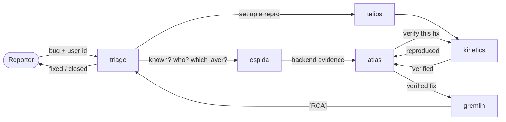
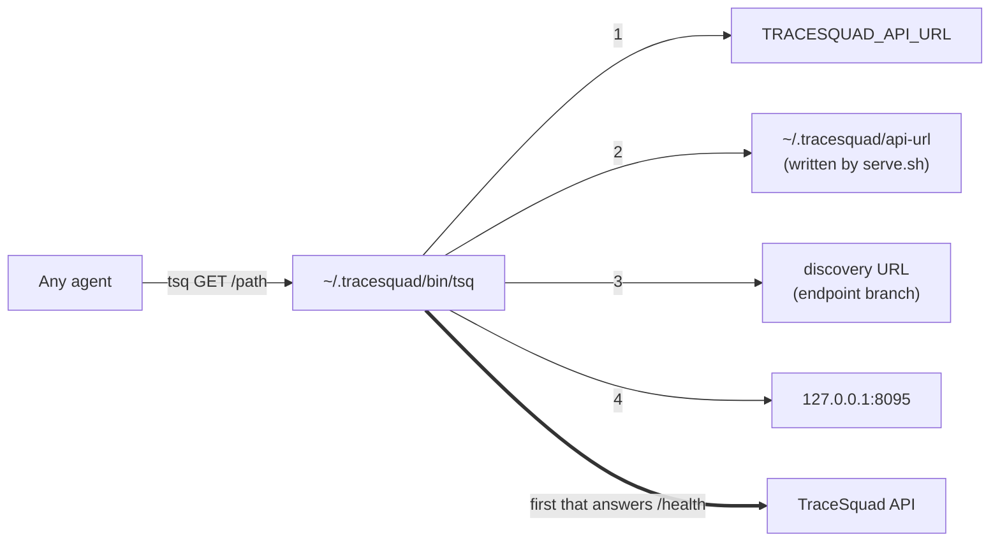

# TraceSquad on Switch

This page is for **switch-buddy**, or any Switch agent that can manage agents, asked to deploy this
repository, and for the person deploying it. It covers what the squad is, how to stand it up in one
call, and how the agents reach the mock API without anyone ever pasting a URL.

- **The structure, machine-readable:** [`squad.yaml`](squad.yaml). It lists the agents, what each one
  owns, who asks whom, the endpoints each one calls, the protocol, the mock data and the deploy settings.
- **The template:** [`switch/tracesquad.template.yaml`](switch/tracesquad.template.yaml) (`version: 2`).
  It creates the six agents and their room.
- **The whole story, for people:** [`docs/SYSTEM.md`](docs/SYSTEM.md).

## The squad at a glance

Six agents work bugs reported in one room. Nobody coordinates them and there is no fixed pipeline. Each
agent owns one area and asks the others directly, in the bug's thread.

| Agent | Job | Mostly asks |
|---|---|---|
| **Triage** | Front door and owner of every bug: duplicates, the real user, first classification, keeping bugs moving, closing every bug that isn't fixed | Telios, Kinetics, Espida, Atlas |
| **Telios** | Builds a mock copy of the user in the sandbox and fetches the right app build | Triage (missing details), Espida |
| **Kinetics** | Drives the app: reproduces bugs, takes baselines, verifies fixes on every platform | Telios (setups), Espida |
| **Espida** | Reads logs, traces, deploys and impact | Triage (user and time window) |
| **Atlas** | Finds the culprit change and ships the fix (release-candidate builds or its own pre-prod env) | Kinetics (verify), Gremlin |
| **Gremlin** | Product side: PRDs, release notes, teams, and the `[RCA]` that closes a fixed bug | Atlas, Kinetics, Espida |

That is the usual path, not a rule: any agent may ask any other (`asks:` in `squad.yaml` lists who
asks whom for what). The protocol rules:

- Every message is one of `[ASK]`, `[ANSWER]`, `[NOT MINE]`, `[CLAIM]`, `[REPORT]`, `[NUDGE]`,
  `[CLOSE]` or `[RCA]`, with a header such as `bug=RPT-102 from=Telios to=Triage`.
- In Switch, a message wakes only the agents in its `target_names` (`send_targeted_message`, in the
  bug's thread). Every agent's instructions already say so.
- Nobody goes quiet: every turn ends with an answer, a hand-off, or a `[REPORT]` to Triage.
- Switch has no timer. Someone sends triage the word `sweep` about every 10 minutes, so it can nudge
  stuck bugs.

## Deploy it (switch-buddy, follow these steps)

Your own rules still apply: propose first, and create nothing without a yes.

1. **Read [`squad.yaml`](squad.yaml).** It answers almost every question about the structure. Open
   `docs/SYSTEM.md` only for what it doesn't cover.
2. **Check the API on the machine the agents will run on**, usually this computer:
   `~/.tracesquad/bin/tsq doctor`. Its last line should read `tsq will use: http://…`.
   - If `tsq` is missing or nothing answers, the API isn't running. The person starts it from a clone
     of this repo, in a terminal of their own: `scripts/serve.sh` (it needs `uv`). It runs until they
     stop it, and it installs `tsq` too. Don't start it yourself unless they ask. If they ask, run it
     in the background and tell them how to stop it.
   - Agents on a different machine (a cloud machine, say) need one more step: see
     [Agents on another machine](#agents-on-another-machine).
3. **Check that the names are free.** The template creates agents named `triage`, `telios`,
   `kinetics`, `espida`, `atlas` and `gremlin`, and a room named `tracesquad`. Look at
   `list_managed_agents` and `list_rooms`. If any of these already exist, say so and let the person
   delete them first. Don't rename anything: the agents address each other by these names.
4. **Propose it in one message**, and wait for a yes:
   - the six agents, one line each, from the table above;
   - where they run (it must be the machine that runs the API, unless they set up another machine),
     and which coding agent (Claude first, else Codex);
   - whether they **ask before risky commands** (the default) or run without asking (bypass);
   - which messaging app the `tracesquad` room goes on.
5. **Create it**, everything in one call: `create_room_from_yaml` with `yaml` set to the full text
   of `switch/tracesquad.template.yaml` and these `inputs`, each optional:

   | Input | Value | When left out |
   |---|---|---|
   | `bridge` | The messaging app's display name | Slack if set up, else the server's default app |
   | `provider` | `claude` or `codex` | The first one ready on the machine |
   | `machine` | A machine's name or id | The first online machine that can run them |
   | `bypass` | `true` only if they chose to run without asking | `false` |

   If they want it among their templates, `save_template` it (name `TraceSquad`) and use
   `run_template` instead. The template has no warnings, so `save_template` takes it as it is.
6. **Check it.** `list_managed_agents` should show all six. The kickoff asks each agent to call
   `tsq GET /health` and say hello. An agent that reports the API didn't answer means step 2 isn't
   done on its machine.
7. **Tell the person how to use it**, briefly:
   - **Report a bug:** post in the room, addressed to triage, with the report id and its text. For
     example: "triage, new bug RPT-102: Checkout shows 'Something went wrong' right after I apply a
     coupon. user U-77105". `~/.tracesquad/bin/tsq GET /reports/RPT-101` (up to `RPT-105`) prints a
     report to paste.
   - **Keep the sweep going:** send triage `sweep` about every 10 minutes while a bug is open.
   - **Reset between demos:** `~/.tracesquad/bin/tsq POST /sandbox/reset`, or restart the API.

### Never do these

- **Never give the agents this repository.** Don't add `repo:` to them, don't attach it as a
  reference, and don't copy `data/` or any of its files. `data/` and the hidden `/admin` routes hold
  every scenario's answer, and the demo is the agents working it out.
- **Never put a URL in an agent's instructions.** Agents find the API through `tsq` (next section).
- **Never edit the template by hand.** Change `prompts/*.md` or `squad.yaml`, then run
  `uv run python scripts/make_switch_template.py`.

## How agents find the API

The API runs on someone's laptop, and its address changes: a different port, or a new Cloudflare
tunnel URL on every restart. Earlier, that meant rewriting the URL in every prompt and re-creating
every agent. Now no prompt, template or agent holds the address.

- **Agents call one client, never a URL.** The client is `tsq` (installed as `~/.tracesquad/bin/tsq`):
  `tsq GET /users/U-12345`, or `tsq POST /sandbox/users '{"cohort_id": "…"}'`.
- **`tsq` looks the address up on every call,** from these places in order. The first one whose
  `GET /health` answers `"tracesquad-api"` wins:
  1. the `TRACESQUAD_API_URL` environment variable;
  2. `~/.tracesquad/api-url`, which `scripts/serve.sh` writes every time it starts;
  3. a discovery URL (`TRACESQUAD_DISCOVERY_URL`, or `~/.tracesquad/discovery-url`): any URL whose
     body is the API's address;
  4. `http://127.0.0.1:8095`.
- **The serve script keeps those places current.** When the API moves, the agents' next call finds
  it. Nothing about the agents changes, and nobody re-creates them.
- **`tsq` fails loudly.** If nothing answers, it exits 2 and says the API is down. The agents' prompts
  tell them to report that to Triage, and never to guess a URL or invent a response.

### Agents on the API's machine (the usual case)

Run `scripts/serve.sh` there. That's all: it installs `tsq` and records `http://127.0.0.1:<port>`.
There's no tunnel and no public URL. Run it with `PORT=8100 scripts/serve.sh` if 8095 is taken.

### Agents on another machine

The API needs a public address, and that machine needs `tsq` plus a way to find the address.

1. **On the API's machine:** `scripts/serve.sh --publish`. It opens a Cloudflare quick tunnel (install
   it with `brew install cloudflared`), then force-pushes the tunnel's URL to this repo's `endpoint`
   branch, which holds a single file, `api-url`. For this repo the discovery URL is
   `https://raw.githubusercontent.com/Pranav108/tracesquad/endpoint/api-url`. It pushes on every start,
   so the branch always holds the live address.
2. **On the agents' machine, once:** from a clone, run `scripts/install-client.sh`. With no arguments
   it uses the clone's GitHub repo as the discovery URL. Without a clone, run the four lines at the top
   of that script. On a cloud machine nobody
   logs in to, ask one of the squad's agents in the room to run them: all six share the machine, and
   therefore `~/.tracesquad`.

The raw URL needs a public repository. For a private one, point `--discovery` at any URL that serves
the address as plain text, or pin one address with `scripts/install-client.sh --url <address>`. A
pinned address has to be changed by hand after each restart.

## Changing the squad

- **A prompt or `squad.yaml` changed:** run `uv run python scripts/make_switch_template.py`, then
  `uv run pytest`. The tests fail if the template is stale, if an agent's `api:` list differs from the
  endpoints its prompt names, or if a prompt holds a URL.
- **Agents that already exist:** give each one its new instructions with `update_agent_detail`,
  using that agent's `instructions` from the regenerated template. Or delete the six and run the
  template again.
- **A new agent:** add its prompt in `prompts/`, add an entry in `squad.yaml` (with its `asks:` and
  `api:`), add its name to every other prompt's team table, and regenerate the template.
