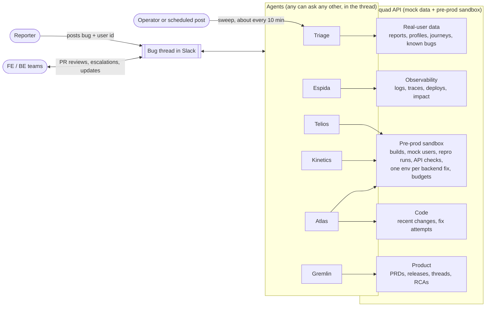
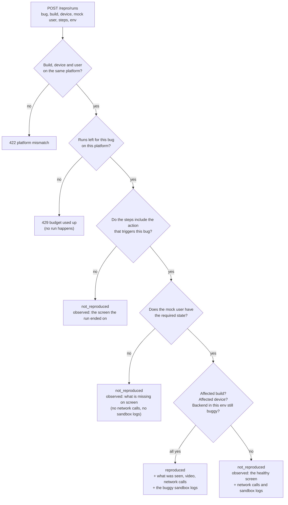
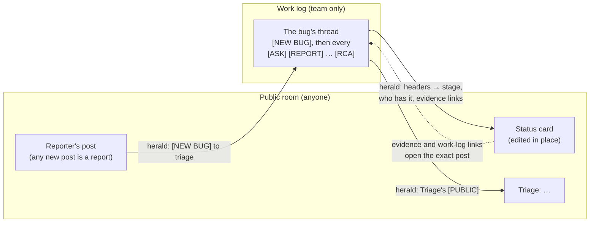
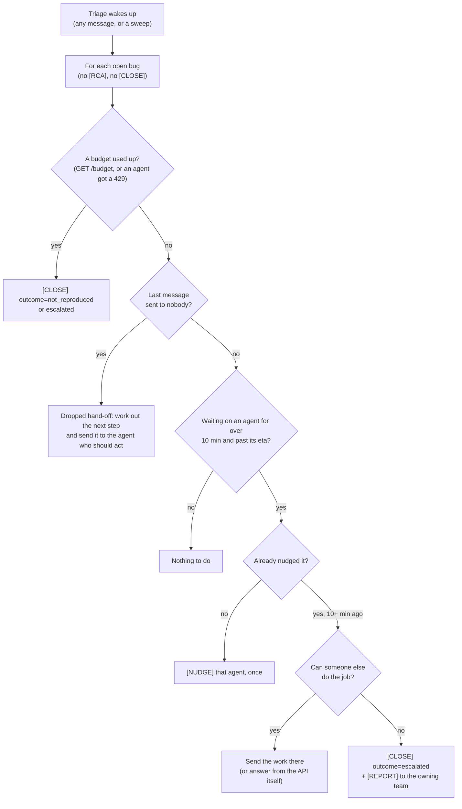
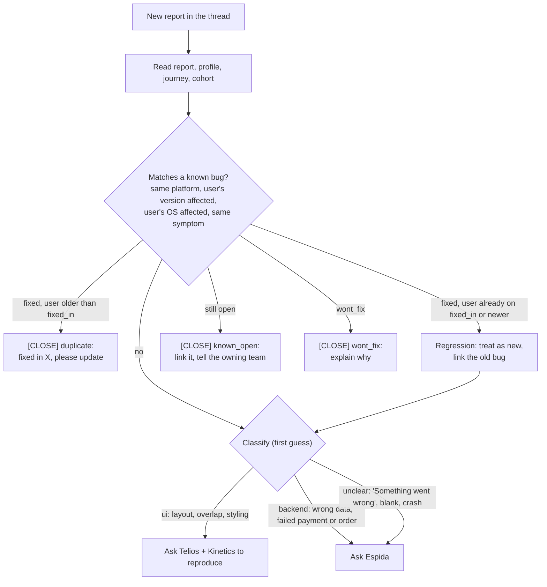
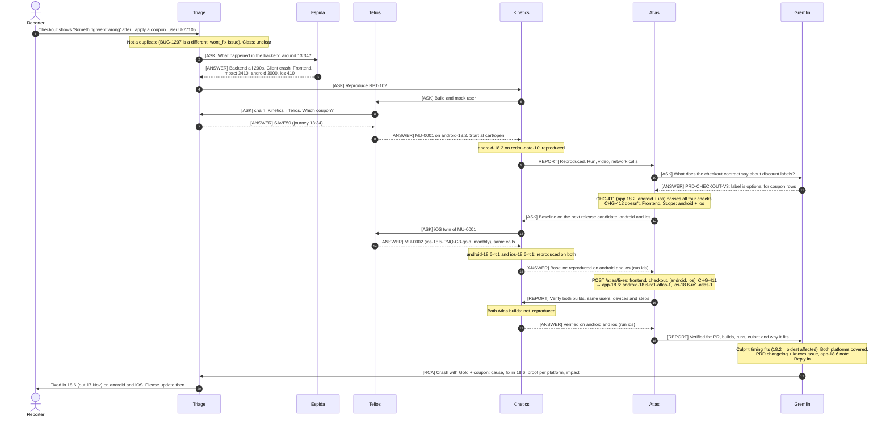
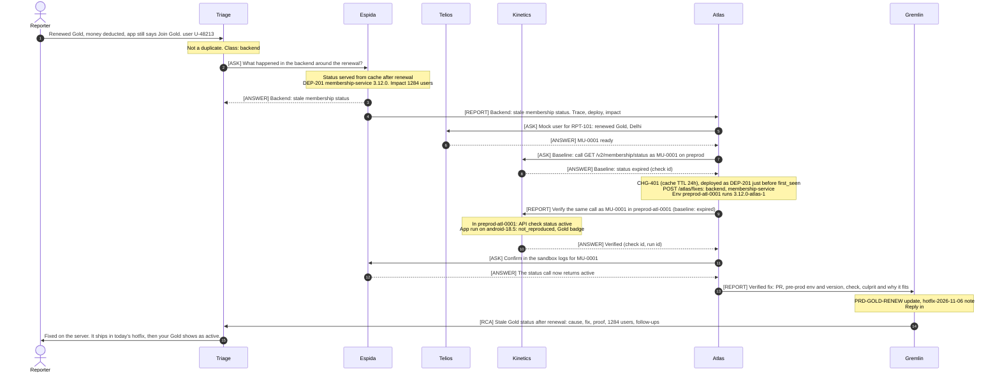
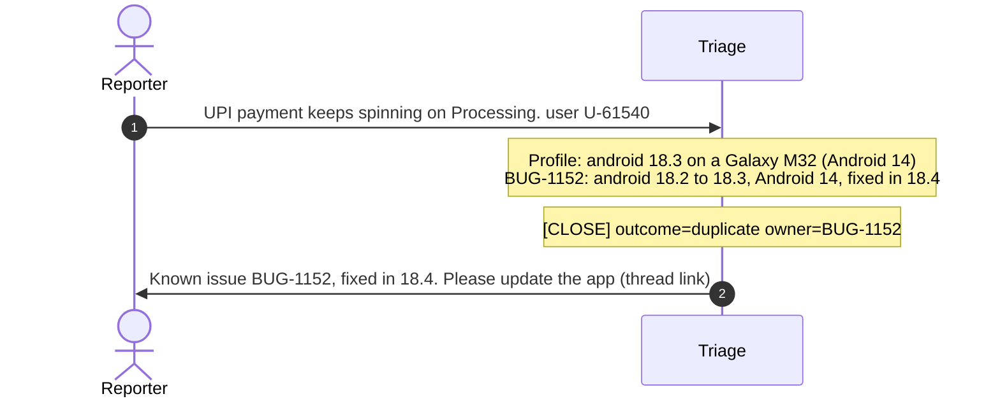
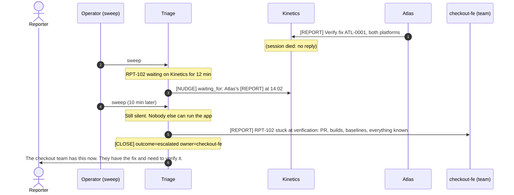

# TraceSquad: how the system works

People report app bugs in a Slack channel. A small team of AI agents picks each report up and works out:
- whether it is a known bug
- who the affected user is
- whether the bug is in the backend, the frontend, or both

When the bug is new, the agents reproduce it with a mock copy of the user, **fix it** (a PR plus new
app builds on the next release candidate, or a deploy to a pre-prod env of its own), **verify** the fix on every affected
platform, and **close the loop**: they update the PRD and release notes, tell the teams and related
channels, and post a final RCA. Every bug ends with exactly one closing message, including the bugs
that can't be fixed.

This document explains:

1. [The agents](#1-the-agents): what each one does and doesn't do
2. [The big picture](#2-the-big-picture)
3. [The mock data they work with](#3-the-mock-data)
4. [How they talk to each other](#4-how-the-agents-talk)
5. [Keeping bugs moving, and how they end](#5-keeping-bugs-moving-and-how-they-end)
6. [Each agent's prompt](#6-each-agents-prompt)
7. [How they reach a conclusion](#7-how-they-reach-a-conclusion)
8. [The flows, step by step](#8-the-flows-step-by-step), with sequence diagrams
9. [Running the demo](#9-running-the-demo)

> Everything here is a demo. The users, logs, builds and bugs are hand-written mock data served by
> the **TraceSquad API**, a small API in this repo. No real user data is involved. The same structure, as
> data, is in [`squad.yaml`](../squad.yaml); deploying it on Switch is in [`SWITCH.md`](../SWITCH.md).

---

## 1. The agents

There is **no fixed pipeline and no central coordinator**. Each agent owns one area. Any agent can
ask any other agent a question, and the agent that's asked answers only from its own area. The order
of work emerges from those questions. One agent, Triage, owns each bug from report to close, so
somebody always notices when a bug stops moving.

| Agent | One-line job | Owns | Never does |
|---|---|---|---|
| **Triage** | Front door and owner of every bug | The bug and its Slack thread, the reporter, duplicate checks, the real user's profile and journey, the first classification, **keeping the bug moving**, **closing every bug that isn't fixed** | Reproduce, read logs in depth, fix |
| **Telios** | Prepares reproductions | Mock users and their data in a sandbox (including **twins** on the other platform), login credentials, the right app build for a version | Reproduce or test anything, or touch real users |
| **Kinetics** | Drives the app and checks fixes | Reproducing in the app; **baselines on the next release candidate**; verifying frontend fixes in the app on **every affected platform**, and backend fixes with an API call and an app run **in the fix's own pre-prod env** | Create data (it asks Telios) or fix code |
| **Espida** | Reads the system's logs | Backend and client logs (prod and sandbox), traces, deploys, error impact by app version **and platform** | Change anything, or post personal data |
| **Atlas** | Owns the fix | Finding the culprit change **and showing it fits the evidence**, scoping every affected platform, opening the PR, shipping builds on the next release candidate (frontend) or a deploy to its own pre-prod env (backend) | Merge PRs, touch prod, claim a fix works before it's verified, or fix only the reporter's platform |
| **Gremlin** | Product and program manager | PRDs, the release calendar, related threads in other channels, informing teams, the final RCA, which **closes a fixed bug** after Gremlin checks the culprit and the platform coverage | Investigate, fix or verify |
| **FE / BE teams** | People | Reviewing and merging Atlas's PRs, owning their features, and taking over escalated bugs | — |

A simple way to remember the split:
- **Triage** knows *who the user is and what they did*, and owns *where the bug stands*.
- **Espida** knows *what the system did*.
- **Telios** builds *a copy of the user's situation*, and **Kinetics** *acts it out*.
- **Atlas** *changes the code*, and **Gremlin** *tells everyone what changed and why*.

---

## 2. The big picture



The **bug thread** is the shared record. Every question, answer, claim, report and closing message is
posted there, so any agent can read what's already known before asking. The **TraceSquad API** is the
agents' window onto the "world": the real user, the logs, the code history, the product docs, and a
pre-prod sandbox where fixes are tried and proven. Each backend fix gets a pre-prod env of its own,
and the API holds every bug to a budget.

The loop in one line:
1. **Triage** checks and classifies.
2. **Espida**, or **Telios** + **Kinetics**, confirm the bug.
3. **Atlas** finds the culprit, scopes the platforms, gets a baseline on the next release candidate, and fixes.
4. **Kinetics** verifies the fix on every platform.
5. **Gremlin** checks the result, updates the product side and posts the RCA.
6. **Triage** tells the reporter.

Triage watches the whole way, and closes every bug that ends any other way.

---

## 3. The mock data

All data lives in JSON files under `data/`. `shared.json` holds what every scenario uses, and there is
one file per scenario in `data/scenarios/`. The API serves it read-only. The only thing that changes
while the demo runs is the **sandbox**: mock users, Atlas's builds and pre-prod envs, sandbox logs,
what each bug has used of its budget, and Gremlin's writes. The sandbox lives in memory and resets on
restart.

### 3.1 What exists, and who reads it

| Data | What it holds | Endpoint | Used by |
|---|---|---|---|
| Reports | The bug report: text, user id, time, attachments. Five are prepared (`RPT-101` to `RPT-105`); Triage files community posts under their herald id | `GET /reports/{report_id}`, `POST /reports` | Triage |
| Known bugs | The bug database: status (`open`, `fixed`, `wont_fix`), affected platforms, versions and OS, `fixed_in`, thread link, error signature | `GET /known-bugs` | Triage |
| User profiles | Platform, app version, device, city, area, group, plan, cohort | `GET /users/{user_id}` | Everyone |
| Journeys | What the user did, in order (screen, action, params) | `GET /users/{user_id}/journey` | Everyone |
| Cohorts | The user's combination, `platform-version-city-group-plan`, with labels | `GET /cohorts/{cohort_id}` | Triage, Telios |
| Logs, traces | Backend and client log lines (prod, sandbox runs and API checks; sandbox lines name their `preprod_env`) | `GET /logs`, `GET /traces/{trace_id}` | Espida |
| Deploys, impact | Prod deploys; users hit per error signature, **by app version and by platform** | `GET /deploys`, `GET /impact/{error_signature}` | Espida, Atlas, Gremlin |
| Builds | Every app build, the **18.6 release candidates** (`android-18.6-rc1`, `ios-18.6-rc1`), and Atlas's `-atlas-<n>` builds | `GET /builds`, `GET /builds/{build_id}` | Telios, Kinetics, Atlas |
| Devices | Phones to run on: model, OS version, screen size | `GET /devices` | Kinetics, Triage |
| Setup APIs, mock users | How Telios builds a mock user, and the users it built | `GET /setup-apis`, `/sandbox/users…` | Telios, Kinetics |
| Repro runs | Kinetics running a build on a device with a mock user, **for one bug**, against shared pre-prod or a fix's env | `POST /repro/runs` | Kinetics |
| API checks | Kinetics calling a backend endpoint as a mock user, **for one bug**, on shared pre-prod or a fix's env | `POST /api-checks` | Kinetics |
| Pre-prod envs | Service versions in shared pre-prod (`preprod`) and in each backend fix's own env (`preprod-atl-<n>`) | `GET /sandbox/services?env=` | Espida, Atlas, Telios |
| Recent changes | Merged PRs per repo and area, with platforms and release version (the culprit hides among distractors) | `GET /changes` | Atlas, Gremlin |
| Fix attempts | Atlas's fixes: PR, and builds per platform with the release they ship in, or a pre-prod env with the new service version | `POST /atlas/fixes`, `GET /fixes` | Atlas (others read) |
| Budgets | What each bug has used and has left: fix attempts, app runs per platform, API checks | `GET /budget/{bug_ref}` | Everyone; Triage watches it |
| PRDs | Feature docs: sections (including contracts), known issues, changelog | `GET /prds`, `POST /prds/{prd_id}/updates` | Gremlin |
| Releases | App releases (18.5 released, 18.6 in QA until 10 Nov and out 17 Nov, 18.7 planned) and the backend hotfix train | `GET /releases`, `POST /releases/{release_id}/notes` | Gremlin |
| Threads | Conversations in other channels (support, QA, design, on-call, release) | `GET /threads?q=`, `POST /threads/{thread_id}/replies` | Gremlin |
| RCAs | The final write-up per fixed bug | `POST /rca`, `GET /rca/{bug_ref}` | Gremlin |
| Teams | Who owns which service or screen, and their channel | `GET /teams` | Triage, Espida, Atlas, Gremlin |

Atlas's and Gremlin's data per scenario:

| Scenario | Culprit change (distractors exist for each) | Affected platforms | PRD | Related threads |
|---|---|---|---|---|
| GOLD-01 | `CHG-401` membership-service: status cache TTL 24h, invalidation async | backend (all) | `PRD-GOLD-RENEW` | `#gold-support` (members see Join Gold) |
| CART-02 | `CHG-411` app 18.2: new DiscountRow component | **android + ios** (reporter is on android) | `PRD-CHECKOUT-V3` (contract: coupon `label` optional) | `#checkout-v3` (QA saw the crash in October) |
| MENU-03 | `CHG-421` iOS 18.4: name and rating on one row | ios | `PRD-RESTO-HEADER` (designed for 390pt+ screens) | `#design-reviews` (a designer flagged SE names before launch) |
| TRACK-05 | `CHG-431` order-tracking-service: ETA as a range for all clients | backend (old android apps break) | `PRD-TRACK-ETA` (old apps only understand v1) | `#logistics-oncall`, `#app-release` |
| PAY-04 | `CHG-441` (the old 18.4 fix) | — | — | — (a duplicate) |

### 3.2 The user's "combination" (cohort)

Every user belongs to one combination of five dimensions:

| Dimension | Values |
|---|---|
| Platform | android, ios |
| App version | 18.2, 18.3, 18.4, 18.5 (current) |
| City | DEL Delhi NCR, BOM Mumbai, BLR Bengaluru, PNQ Pune, HYD Hyderabad |
| Group (10 categories) | G1 New, G2 Occasional, G3 Regular, G4 Frequent, G5 High spender, G6 Lapsed, G7 Gold loyalist, G8 Corporate, G9 Student, G10 Late-night |
| Plan | none, gold_monthly, gold_annual, gold_trial |

These combine into one cohort id, for example `android-18.5-DEL-G7-gold_annual`. Telios creates the
mock user with exactly this cohort, so the reproduction runs under the same conditions as the real user.

When a bug also affects the other platform, Telios builds a **twin**: the same city, group, plan and
setup calls, with the platform swapped and the newest released version on that platform (for example
`ios-18.5-PNQ-G3-gold_monthly` for an android 18.2 user).

### 3.3 The five scenarios

| ID | Bug as reported | What's really wrong | Class |
|---|---|---|---|
| GOLD-01 | "Renewed Gold, money deducted, app still says Join Gold" | membership-service 3.12.0 caches status for 24h and doesn't clear the cache on renewal | backend |
| CART-02 | "'Something went wrong' at checkout after a coupon" | The app crashes drawing a discount row that has no label, on android **and** iOS. The backend is fine | frontend (reported as unclear) |
| MENU-03 | "Restaurant name overlaps the rating" | A long name breaks the layout on small iPhones only | ui |
| PAY-04 | "UPI payment stuck on Processing" | Known bug BUG-1152, already fixed in 18.4. The user is on 18.3 | duplicate |
| TRACK-05 | "Track order screen is blank" | A backend deploy changed the ETA format, and app versions 18.2–18.3 can't read it | both (contract mismatch) |

Each scenario also contains **distractors**, so the agents have to reason rather than pattern-match:
a similar-but-different known bug, an unrelated 404 or slow call in the logs, and an unrelated deploy.

### 3.4 The sandbox and how a repro run is decided

Telios builds a mock user with **setup APIs**. Each call adds **tags** describing the user's state,
and each call can require tags from earlier calls:

| Setup API | Requires | Adds |
|---|---|---|
| `POST /sandbox/users` (`create_user`) | — | `user`, `cohort:<id>` |
| `set_address` | user | `address:<city>` |
| `set_group` | user | `group:<group>` |
| `activate_plan` | address | `plan:<plan>`, `plan_status:active` |
| `renew_plan` | plan | `gold_renewed` |
| `add_payment_method` | user | `payment_method:<type>` |
| `fill_cart` | address | `cart`, `cart_restaurant:<id>` |
| `apply_coupon` | cart | `coupon:<code>` |
| `place_order` | address, payment_method | `order:active` |

Calling them in the wrong order returns **409**, with a message naming the call to make first. A value
outside the known lists (city, group, plan, payment type) returns **422**.

A repro run is always **for one bug** (`bug_ref`). The API checks only that bug's hidden **repro
rule**, so a run can't "reproduce" a different bug by accident. The bug reproduces only if all of
these hold:



This is why the details matter. The wrong device, a skipped coupon, or an old build all give
`not_reproduced`, but each one says something different in `observed`, so Kinetics knows what to
change next:

| The run... | `observed` says, for example | Kinetics's next move |
|---|---|---|
| never reached the bug's screen | "Completed all 2 steps, ending on cart (open). No problem seen." | Add the missing step from the journey, with the same params |
| reached it without the user's state | "Checkout shows 'Your cart is empty'" (and `network` is empty) | Ask Telios for that state |
| reached it, and the bug didn't happen | "Checkout shows both discount rows (Gold discount ₹30 and SAVE50 ₹50) and the total" | Check the device and the build. If both match the user's, the bug may be fixed |

A run never names the rule it failed: it describes the screen, the way a person testing the app
would. A run with missing state is never a pass, because it shows nothing about the bug.

The **18.6 release candidates still have the frontend bugs** (CART-02 on both platforms, MENU-03 on
iOS). The fix isn't in 18.6 until Atlas makes it. That's what makes the release candidate a
baseline: the bug shows there before the fix and not after it. TRACK-05 doesn't show on the release
candidate at all, because newer apps understand the new ETA format. The run's network calls show the
backend still sending the new format. That's the clue that only old apps break, so the fix must be in
the backend.

### 3.5 Pre-prod: one env per backend fix

App fixes were always kept apart: each attempt gets its own `-atlas-<n>` builds. Backend fixes now
work the same way. Each backend attempt is deployed to a **pre-prod env of its own**, like a per-PR
preview environment:

| Env | What runs there | Used for |
|---|---|---|
| `preprod` (shared) | The same service versions as prod, bugs included. Atlas never deploys here; only the operator can (`POST /sandbox/deploy`) | Baselines: the buggy response before any fix |
| `preprod-atl-0001` | `preprod`, plus attempt ATL-0001's service at `<version>-atlas-1` | Kinetics's check and app run for that attempt, and Espida's comparison |
| `preprod-atl-0002` | `preprod`, plus attempt ATL-0002's service | The same, for the next attempt, whichever bug it belongs to |

Kinetics passes `env` to `POST /api-checks` and `POST /repro/runs`. Espida sees which env each sandbox
log line came from (`preprod_env`), and `GET /sandbox/services?env=` shows the versions in one env.
Mock users aren't tied to an env, so the same user gives the baseline on `preprod` and the check in
the fix's env.

Before this, pre-prod was one shared environment. A backend fix replaced the service version for
everyone, and a wrong attempt was never rolled back. A later wrong attempt on the same service (or
another bug's deploy) quietly undid a fix that had already been verified, and two bugs worked at the
same time interfered with each other. Now nothing an agent does can change another attempt's env.

### 3.6 Budgets the API enforces

| Budget, per bug | Limit | Why that number | Over the limit |
|---|---|---|---|
| Fix attempts (`POST /atlas/fixes`) | 2 | Atlas gets two tries before the team takes over | 429; no PR, build or env is created |
| App runs (`POST /repro/runs`), per platform | 7 | 3 to reproduce, plus a baseline and a check for each of 2 fix attempts | 429; no run happens |
| API checks (`POST /api-checks`) | 4 | A baseline and a check for each of 2 fix attempts | 429; no check happens |
| Questions | about 20 | Questions are chat messages, which the API never sees | Kept by the prompts only |

A call that fails for another reason (404, 422) costs nothing. `GET /budget/{bug_ref}` shows each
budget's `used`, `limit` and `left`. A 429 tells the agent to stop and report to Triage, and Triage's
watch also checks budgets (see [section 5](#5-keeping-bugs-moving-and-how-they-end)).

Before this, the limits lived only in the prompts. Nothing stopped an agent that lost count, and
Atlas could keep guessing targets until one passed verification.

### 3.7 What's hidden from the agents

- `/admin/*` holds each scenario's expected answer and its repro rules.
- **Whether an Atlas fix is right.** A fix works only if it:
  - changes the right layer and target,
  - names the right **culprit** change, and
  - for the app, is built for a platform the bug affects.

  A right and a wrong fix get the same kind of response: a PR, plus `-atlas-<n>` builds or a pre-prod env. Only a repro run or an API check shows whether the bug is gone, and with two attempts at most, Atlas can't find the answer by trial and error.
- **The repro rules themselves.** A run describes the screen it ended on; it never says which condition failed (wrong device, wrong build, missing tag).
- **Operator-only routes:** `POST /sandbox/deploy` (changes shared pre-prod), `POST /fixes/{fix_id}/publish` and `POST /sandbox/reset`. These are for the person running the demo.

All of the above are left out of `/openapi.json`, and no prompt mentions them.

---

## 4. How the agents talk

### Two rooms and the herald

People report bugs in a **public room** that anyone in the community can read. Working one bug takes
the squad dozens of messages, and putting them all in the reporter's thread buries the answer. So the
squad works in a second room, the **work log**: a private channel only the team can read.

The **herald** links the two ([HERALD.md](HERALD.md)). It is a bot, not an agent: it reads headers
and never writes prose of its own.



| Who | Reads |
|---|---|
| The reporter, anyone in the community | The card and Triage's `[PUBLIC]` messages |
| Developers, product | The card's evidence links, each straight to the message that carries it |
| Anyone checking how the squad got there | The bug's whole work-log thread |

Agents never post in the public room. Replies people write in a bug's public thread reach Triage in
the work log as `[FROM PUBLIC]`.

### Messages

All conversation happens **in the bug's thread in the work log**. Agents never call each other
directly. They post a message addressed to another agent, and that agent replies in the thread.
Every message uses one of these formats:

| Message | Who sends it | Used for | Shape |
|---|---|---|---|
| `[ASK]` | Anyone | Asking the owner of some information | `bug=… from=… to=… chain=…`, then `question:` and `why:` |
| `[ANSWER]` | Anyone, back to the asker | Replying with evidence | `answer:`, `evidence:` (which API call or record), `confidence:` high, medium or low |
| `[NOT MINE]` | Anyone, back to the asker | "That's not my area, ask X" | `try=<agent who owns it>` |
| `[CLAIM]` | Anyone | "I'm starting on this", so two agents don't duplicate work | `doing: …` |
| `[REPORT]` | Anyone | A result for another agent, a team or the thread (e.g. Kinetics → Atlas), or "I'm stuck" to Triage | `summary:`, `evidence:`, `next:` |
| `[NUDGE]` | **Triage only** | Reminding an agent of a message it hasn't answered | `waiting_for:` the message and when it was sent |
| `[CLOSE]` | **Triage only** | Closing a bug that didn't end in a fix | `outcome=`, then `summary:`, `owner:`, `evidence:` |
| `[RCA]` | **Gremlin only**, sent to Triage | The final write-up, which closes a fixed bug | `what_happened:`, `root_cause:`, `fix:`, `verification:`, `impact:`, `follow_ups:` |
| `[PUBLIC]` | **Triage only**, a plain message | Talking to the reporter: a question only they can answer, or the outcome. The herald copies it into the public thread | Plain words; never ids, env names, service versions or work-log links |
| `[NEW BUG]` | **The herald**, to Triage | Opens the bug's work-log thread with the report as posted | `reporter=`, then the report quoted |
| `[FROM PUBLIC]` | **The herald**, to Triage | What someone wrote in the bug's public thread | `author=`, then their words quoted |

Nobody posts status updates: the herald's card shows the progress, built from these headers.

**Ready for temporary channels.** Every header can carry `channel=<channel>`. In the future, a bug's
discussion can move to a temporary channel. Gremlin then posts the `[RCA]` there **and** back in the
original bug thread. Nothing creates or moves channels yet.

Example exchange: Telios needs a coupon code that only the real user's journey contains.

```
[ASK] bug=RPT-102 from=Telios to=Triage chain=Kinetics→Telios
question: Which coupon did the user apply before the error?
why: needed to set up the mock user's cart

[ANSWER] bug=RPT-102 from=Triage to=Telios
answer: SAVE50
evidence: journey of U-77105, event 13:34 cart/apply_coupon
confidence: high
```

### Rules every agent follows

1. **Read the thread first.** The answer may already be there.
2. **Ask the owner.** Use the table in [section 1](#1-the-agents). Answer only from your own area.
3. **A message wakes only the agents it is sent to.** Agents sleep until a message targets them. Whoever is in `to=` must also be the message's target on the chat platform (in Switch, the `target_names` of `send_targeted_message`). A `to=` alone wakes nobody. `[ANSWER]` and `[NOT MINE]` go back to the agent who asked.
4. **Never go quiet.** Every turn ends with one of these:
   - an `[ANSWER]` to whoever asked,
   - an `[ASK]` or `[REPORT]` to the agent who acts next, or
   - a `[REPORT]` to Triage saying what's blocking (the API is down, a budget is used up, nobody knows).

   Long work starts with a `[CLAIM]`, with `eta=<minutes>` if it takes more than 10 (a build can take 18). A `[NUDGE]` is answered before anything else.
5. **Carry the chain.** When a question is passed on, add yourself to `chain`. Never ask an agent already in the chain, and stop after **3 hops** with "unknown".
6. **Budget per bug:**
   - about 20 questions in total,
   - at most 3 repro runs **per platform** to reproduce,
   - one baseline and one run per platform for each fix attempt,
   - at most **2 fix attempts** by Atlas.

   When a budget runs out, the agent reports to Triage, which escalates. The API enforces the totals
   (2 fix attempts, 7 app runs per platform, 4 API checks) and answers 429 past them; see
   [3.6](#36-budgets-the-api-enforces). Questions are counted by the agents only.
7. **Cite evidence:** every fact names the API call, log id, trace id, run id or check id it came from.

---

## 5. Keeping bugs moving, and how they end

### 5.1 Why bugs stall

Agents sleep until a message targets them, and **nothing in the system runs on a timer** (Switch has
no scheduler). Without a coordinator, a bug silently stops when:
- an agent writes `to=Atlas` but doesn't target Atlas on the platform, so Atlas never wakes up,
- an agent's session dies, or its machine sleeps, partway through a job,
- an agent runs out of budget (the API answers 429) or hits an error, and simply stops,
- a path ends with nobody owning the next step, e.g. "not reproduced" or "two fix attempts failed".

Rules 3 and 4 above prevent most of these: messages always wake their target, and nobody ends a turn
without handing the bug on. Triage catches the rest.

### 5.2 Triage keeps watch

Triage owns every bug until it closes. It checks its open bugs **every time it wakes up**, whatever
woke it. To make sure it wakes up even when nothing else happens, something outside the agents sends
it `sweep` about every 10 minutes. That can be the operator, a scheduled post on the chat platform,
or a cron job posting through a webhook.



An agent that reports to Triage that it is stuck gets the same treatment: Triage sends the work
elsewhere, asks the reporter, or escalates. A used-up budget can't be worked around, so Triage closes
the bug: `not_reproduced` if the runs ran out before the bug showed, otherwise `escalated`.

The one thing this can't catch is Triage itself being down. The operator is the last line of defence
there. A bug thread with no Triage reply to a `sweep` means Triage isn't running.

### 5.3 How a bug ends

Every bug ends with **exactly one closing message**. Gremlin's `[RCA]` closes a fixed bug. Triage's
`[CLOSE]` closes every other bug. Triage is the only agent that talks to the reporter, so it always
has the last word with them.

| Outcome | When | Who decides | Closing message | The reporter hears (from Triage) |
|---|---|---|---|---|
| **fixed** | Kinetics verified Atlas's fix on every affected platform, and Gremlin's checks pass | Kinetics, then Gremlin | Gremlin's `[RCA]`, sent to Triage | What was wrong, and when the fix reaches them: the app release and its date (they must update), or the backend hotfix and its date |
| `duplicate` | Matches a known **fixed** bug, and the user is older than `fixed_in` | Triage | `[CLOSE]` | The known bug, the fixed version, the thread link: please update |
| `known_open` | Matches a known bug that is still **open** | Triage | `[CLOSE]`, plus a `[REPORT]` to the owning team: one more affected user | It's known and tracked, with the link |
| `wont_fix` | Matches a known bug marked **`wont_fix`** | Triage | `[CLOSE]` | Why it works this way, quoting the known bug |
| `already_fixed` | The bug shows on the user's version but not on the next release candidate, and no backend change causes it | Atlas, from Kinetics's baseline | `[CLOSE]` | Which release fixes it, and when it comes out (Gremlin gives the date) |
| `not_reproduced` | Kinetics used its runs, Espida found nothing in the logs, and the reporter had nothing new to add | Kinetics + Espida, then Triage | `[CLOSE]` | What was tried, and what to send if it happens again |
| `escalated` | Atlas's 2 attempts failed, no culprit was found, an agent stayed silent after a nudge, or a budget ran out (the API answers 429) | Whoever hit it, through Triage | `[CLOSE]`, plus a `[REPORT]` to the owning team with everything known | Which team has it now |

For `not_reproduced`, Triage first asks the reporter **once** for what's missing: exact steps, device
and time. If that brings new details, Telios and Kinetics get one more round before Triage closes.

An `inconclusive` verification is not an ending. It means a baseline was missing, so Kinetics gets
the baseline and checks the same fix again. It doesn't use up one of Atlas's two attempts.

---

## 6. Each agent's prompt

The full, ready-to-paste system prompts are in `prompts/`. Those files are the exact text: paste one
into the agent's system prompt and give the agent a shell where `~/.tracesquad/bin/tsq` reaches the API.
On Switch, the template carries them (see [`SWITCH.md`](../SWITCH.md)). All six share the same structure:

1. **Role**: what the agent owns, and what it must never do
2. **Team directory**: who owns what, and what to ask each agent
3. **Tools**: how to call the API through `tsq` (never a URL), then every endpoint the agent uses, with path params, query params, JSON body, allowed values, what comes back, and an example
4. **Playbook**: how the agent works through a bug (this is guidance, not a fixed script)
5. **Shared protocol**: the message formats, the wake-up and "never go quiet" rules, the endings, and the budgets from [section 4](#4-how-the-agents-talk)

Examples in the prompts use made-up values, never scenario ids, so the prompts can't leak answers.
`tests/test_prompts.py` enforces this. It also checks that, in every prompt:
- every endpoint named exists
- no hidden route is mentioned
- the other agents are named
- the API is reached only through `tsq`, and no URL appears
- the protocol includes `channel=`, `[RCA]`, `[NUDGE]`, `[CLOSE]`, every ending, and the "never go quiet" rule

It also checks the key rules of each agent's playbook (Triage's watch and endings, Atlas's culprit
checks and platform scope, Kinetics's release-candidate baselines, Gremlin's checks before closing).

| Agent | Prompt file | Endpoints it's given | The heart of its instructions |
|---|---|---|---|
| Triage | [`prompts/triage.md`](../prompts/triage.md) | reports, known bugs, users, journeys, cohorts, devices, fixes, teams | Check duplicates (with a version-aware rule), classify, route, answer questions about the real user, **keep every bug moving** (nudge, reroute, escalate), and **close every bug that isn't fixed** |
| Telios | [`prompts/telios.md`](../prompts/telios.md) | builds, setup APIs, sandbox users and setup calls, sandbox services, users, journeys, cohorts | Collect the target state, fetch the build first, plan setup calls by their prerequisites, stop just before the buggy step, hand over; build **twins** on the other platform |
| Kinetics | [`prompts/kinetics.md`](../prompts/kinetics.md) | devices, builds, sandbox users, repro runs, API checks, fixes, users, journeys | Reproduce like the real user and report to Atlas (or to Triage when it never reproduces); take **baselines on the next release candidate** per platform; verify app fixes on **every** platform and backend fixes with `POST /api-checks` |
| Espida | [`prompts/espida.md`](../prompts/espida.md) | logs, traces, deploys, impact, teams, sandbox services, users, journeys | Choose the time window from the journey, follow traces, check deploys and impact (**by platform** too), apply the layer rules, answer the asker and report backend causes to Atlas, and confirm backend fixes from the sandbox logs |
| Atlas | [`prompts/atlas.md`](../prompts/atlas.md) | changes, atlas fixes, fixes, impact, builds, sandbox services, traces, reports, users, teams | Find the culprit and show it passes **four checks** (area, timing, platforms, content), decide the layer (asking Gremlin for the intended behaviour), **scope every affected platform**, get a baseline on the next release candidate, submit, retry at most once, hand the verified fix to Gremlin or escalate through Triage |
| Gremlin | [`prompts/gremlin.md`](../prompts/gremlin.md) | PRDs (+updates), releases (+notes), threads (+replies), RCA, teams, fixes, changes, impact | Answer product and release-date questions; after verification, **check the culprit fits and every platform is covered**, update the PRD and release, reply in related threads, inform the teams, and send the `[RCA]` to Triage |

---

## 7. How they reach a conclusion

No single agent decides everything. Each one draws a conclusion inside its own area, backed by
evidence, and the bug's outcome comes from those conclusions together.

### 7.1 Triage: is it new, and what kind of bug is it?



Triage's classification is only a starting point. Espida's evidence or Kinetics's result can
overturn it. In CART-02, for example, the bug looks "unclear" and turns out to be frontend.

### 7.2 Espida: which layer is at fault?

Espida takes the time window from the journey (30 minutes before the first error to 10 minutes after),
pulls the user's backend and client logs, follows every trace with a warning or error, and checks
deploys and impact (by app version **and** platform). Then it applies these rules:

| What the logs show | Verdict | Next |
|---|---|---|
| A backend call failed (4xx/5xx), timed out, or returned wrong or stale data, often right after a deploy | **backend** | Answer the asker, and `[REPORT]` to Atlas |
| Every backend call returned 200 with valid data, but the client logged an error | **frontend** | Answer the asker: Kinetics reproduces, then Atlas fixes |
| A deploy changed a response's shape, and the client errors only on **older app versions** (the impact split shows it) | **both**: a contract mismatch; name the side that broke it | Answer the asker, and `[REPORT]` to Atlas (old apps can't be patched, so the fix is likely backend) |
| Nothing wrong at all | **logs clean**, likely UI-only | Answer the asker: Kinetics reproduces |

Unrelated noise, such as a 404 promo banner or a slow menu call, is ignored unless it lines up with
the error.

### 7.3 Telios: what to set up, in what order

1. **Target state.** From the profile and journey, list everything that must be true for the bug to
   happen: city and area, group, plan (and renewal), payment method, cart, coupon, active order.
   Anything missing goes to Triage as an `[ASK]`.
2. **Build first**, because it can take longest: `GET /builds/<platform>-<app_version>`.
3. **Plan the calls** so every `requires` is met by an earlier call's tags, starting with the user's
   exact cohort.
4. **Stop before the bug.** Telios sets up the state; the steps that trigger the bug are left for
   Kinetics to do in the app. For example, Telios applies the coupon, and Kinetics opens checkout.
5. **A 409 is information.** Add the missing call and carry on, without working around it.
6. **Twins.** When the bug affects the other platform too, Telios repeats the same calls for a twin
   on that platform and names that platform's release candidate build.

### 7.4 Kinetics: did it reproduce?

- Match the real user exactly: their **build** (`platform-app_version`), their **device** (screen size
  and OS matter), and the **steps** from their journey.
- Every run names its bug (`bug_ref`). If the result is `not_reproduced`, read `observed`, change
  **one** thing at a time, and use up to 3 runs per platform. `observed` says which it is (see
  [3.4](#34-the-sandbox-and-how-a-repro-run-is-decided)): the run ended before the bug's screen (a
  missing step), the screen shows missing state (ask Telios), or the screen is healthy (check the
  device and build).
- Read the run's network calls. If a call looks wrong, ask Espida.
- Reproduced: report to Atlas. Never reproduced: report everything tried to **Triage**, which owns
  the `not_reproduced` ending. That is a valid, useful result.

### 7.5 Atlas: which change, which layer, which platforms?

1. **Read the evidence:** Kinetics's repro (observed, network calls) and Espida's findings (failing call, deploy, impact).
2. **Find the culprit** with `GET /changes` for the suspect app screen *and* the service behind it.
   For app changes, look at those released in or before the reporter's app version. App bugs often
   ship weeks before anyone reports them. For service changes, look at those deployed shortly before
   the first error. A change is the culprit only if it passes **all four checks**:

   | Check | App change | Service change |
   |---|---|---|
   | **Area** | Touches the screen in the evidence | Is the service in the evidence |
   | **Timing** | `released_in` is the oldest affected app version | Deployed shortly before the error's `first_seen` |
   | **Platforms** | Its `platforms` include every platform where the bug shows | — |
   | **Content** | Its summary explains the symptom | Its summary explains the symptom |

   The culprit matters for more than the RCA: **the fix is made from it.** Name a distractor, and the
   fix changes the wrong code and verification fails. If no change passes, Atlas reports to Triage
   rather than guessing.
3. **Decide the layer** against the intended behaviour, which Gremlin quotes from the PRD:
   - **Backend:** the service broke its contract, returns wrong or stale data, or changed a response that already released app versions depend on (old apps can't be patched).
   - **Frontend:** the service behaves as the contract says, and the app mishandles it, or the layout is wrong.
4. **Scope every affected platform**, from Espida's impact (`by_platform`), the culprit's
   `platforms`, and reproductions. The reporter's platform is only one of them. In CART-02, the
   reporter is on android, but 410 iOS users hit the same crash.
5. **Get a baseline, then submit.** App fixes are built on the **next release candidate**
   (`android-18.6-rc1`, `ios-18.6-rc1`), because that's what ships. The release that is still in QA
   is the one that gets the fix. So Kinetics first shows the bug on that release candidate, for every
   platform in scope. For backend fixes, Kinetics shows the failing call's buggy response.
   - If the release candidate doesn't show the bug, an app fix would prove nothing. Either a backend change broke old apps (TRACK-05), so the fix goes in the backend, or the next release already fixes it, and Atlas reports `already_fixed` to Triage.
6. **Submit** with `POST /atlas/fixes` (`platforms: [...]` for app fixes), and hand the fix to Kinetics.
   Atlas doesn't learn whether it's right until Kinetics verifies. A backend fix lands in its own
   pre-prod env (`preprod-atl-<n>`), which Atlas names to Kinetics. After two failed attempts, Atlas
   reports everything it tried to Triage, which escalates to the owning team. The API refuses a third.

### 7.6 Kinetics: is the fix real?

| Fix type | How Kinetics checks it | It passes when |
|---|---|---|
| Frontend | For **each** platform: runs the **same steps** with the **same mock user** and device as the baseline, on Atlas's build (`<platform>-18.6-rc1-atlas-<n>`, built on that release candidate) | `not_reproduced` on **every** platform |
| Backend | Calls the endpoint that used to fail with `POST /api-checks` as the mock user **in the fix's env** (`preprod-atl-<n>`), then runs the app once on the user's **original** build in that env. Espida confirms from the sandbox logs with that `preprod_env` | The API response is correct (e.g. `status: active`, `schema_version: 1`), and the app run is `not_reproduced` with a healthy screen |

A wrong fix looks exactly like a right one until this step. It might come from the wrong culprit,
have the wrong target, or miss a platform. Either way, the bug still reproduces, or the API still
returns the buggy response.

Verification needs a **baseline**: the same mock user must have shown the bug before the fix, on the
build the fix was made from (a `reproduced` run on the release candidate, or the buggy API response
on shared `preprod`).
Without one, Kinetics answers `inconclusive`, because a user who never had the bug would look "fixed"
whatever Atlas did.

### 7.7 Gremlin: closing the loop

Once Atlas hands over a **verified** fix, Gremlin first checks two things itself, and asks Atlas if
either fails:
- **The culprit fits the evidence:** the change's release or deploy time matches the impact's oldest version or `first_seen`, and its area and summary explain the symptom.
- **Every affected platform is covered:** every platform in the impact's `by_platform`, and in an app culprit's `platforms`, has a verified build.

Then Gremlin:

1. **Updates the PRD** with a changelog entry, plus a known issue if users must update the app or old versions stay affected.
2. **Notes the release:** the `release` on Atlas's attempt (app-18.6, in QA until 10 Nov) for frontend fixes, or the backend hotfix train.
3. **Searches other channels** (`GET /threads?q=` with the symptom words) and replies in the threads that are really about this issue, such as support, QA, design review or on-call.
4. **Informs the owning team(s)**: the app team for UI or app fixes, and both sides for contract issues.
5. **Writes the RCA** with `POST /rca` and sends the `[RCA]` message to Triage, which closes the bug. The RCA covers what users saw, why (naming the culprit and why it fits), what changed per platform, how it was proven per platform, the impact and follow-ups. Triage then tells the reporter.

---

## 8. The flows, step by step

### 8.1 CART-02: a frontend fix on both platforms, end to end



### 8.2 GOLD-01: a backend fix, verified with an API call



### 8.3 PAY-04: a duplicate, settled by Triage alone



If an agent investigates anyway, the data agrees with that answer:
- Espida finds the same error signature.
- Kinetics reproduces on 18.3 on an Android 14 phone.
- Kinetics doesn't reproduce on 18.4, or on an Android 12 phone.

### 8.4 MENU-03 and TRACK-05 in brief

**MENU-03 (ui, iOS only).**
- Telios fetches `ios-18.5`. Kinetics reproduces only on the iPhone SE (it asks Triage for the device).
- Atlas finds `CHG-421`, the iOS 18.4 header change. Its `platforms` is `[ios]`, and layout bugs log nothing, so the scope is iOS only.
- Kinetics's baseline on `ios-18.6-rc1` on the SE reproduces. Atlas ships `ios-18.6-rc1-atlas-<n>` targeting the `restaurant` screen. Kinetics re-runs on the SE: fixed.
- Gremlin updates `PRD-RESTO-HEADER` (designed for 390pt+ screens), notes the fix on `app-18.6`, replies in `#design-reviews` (where a designer had raised exactly this), and sends the RCA to Triage.

**TRACK-05 (both).**
- Espida finds:
  - the tracking call returning schema v2
  - a client `TypeError` on 18.3
  - deploy DEP-205
  - impact only on 18.2–18.3, android only
- Atlas asks for a baseline on `android-18.6-rc1`: **not reproduced**. New apps cope; only 18.2–18.3 break, and old apps can't be patched. So an app fix would prove nothing and help no one. The fix is **backend**: order-tracking-service serves v1 to apps below 18.4. The culprit is `CHG-431`, deployed as DEP-205 just before the first error.
- Kinetics's baseline API check on `GET /orders/active/track` on `preprod` returns `schema_version: 2`. In the env of Atlas's deploy (`preprod-atl-<n>`) it returns `schema_version: 1`, and the app run on 18.3 in that env is `not_reproduced`.
- Gremlin updates `PRD-TRACK-ETA`, notes the hotfix train, replies in `#logistics-oncall` and `#app-release` (the force-update discussion), informs logistics-be and orders-fe, and sends the RCA to Triage.

### 8.5 When something goes wrong: a stalled verification

Kinetics's session dies after Atlas hands it a fix. Nobody else can run the app, so Triage escalates
rather than letting the bug sit forever.



The same pattern covers the other dead ends:
- When Atlas's two attempts fail, Atlas reports to Triage, and Triage escalates.
- When Kinetics never reproduces, Triage asks the reporter once, then closes as `not_reproduced`.
- When an agent gets a 429, it reports to Triage, which closes the bug: no agent can spend past the budget.

---

## 9. Running the demo

1. **Start the API:** `scripts/serve.sh`. It runs the API on `http://127.0.0.1:8095`, installs the client
   as `~/.tracesquad/bin/tsq`, and records the API's address in `~/.tracesquad/api-url`. Agents call the API
   only through `tsq`, which looks the address up on every call, so no prompt or template holds a URL and a
   restart changes nothing for the agents. Agents on another machine need `scripts/serve.sh --publish`
   (a public tunnel URL, published to the repo's `endpoint` branch); see
   [`SWITCH.md`](../SWITCH.md#how-agents-find-the-api).
2. **Create the agents.** On Switch, deploy `switch/tracesquad.template.yaml` (switch-buddy can do it from
   [`SWITCH.md`](../SWITCH.md)). Elsewhere, paste each `prompts/<agent>.md` as the system prompt and give
   the agent a shell where `tsq` works. Re-run `uv run python scripts/make_switch_template.py` after
   editing a prompt or `squad.yaml`.
3. **Start the herald:** `scripts/herald.sh`, with a Mattermost bot in both rooms
   ([HERALD.md](HERALD.md)). Without it, reports never reach the work log.
4. **Play the reporter.** Post a report's text as a new post in the public room, e.g. the text of
   `GET /reports/RPT-102`. No tag is needed: every new post there is a report. The status card appears
   in your thread within seconds, and Triage files the post in the API under the card's id.
5. **Keep the sweep going.** About every 10 minutes, send Triage `sweep` (in Switch: a message
   addressed to triage in the work log). Do it by hand, with a scheduled post on the chat platform, or with a cron job
   posting through a webhook. Without it, a stalled bug waits until something else wakes Triage.
6. **Let the agents run.** They reproduce the bug, fix it, verify the fix and close it with an `[RCA]`,
   or close it with a `[CLOSE]` when it ends another way. The operator no longer deploys or publishes
   fixes for new bugs.
7. **Check their work** (with `~/.tracesquad/bin/tsq`):
   - `GET /admin/scenarios/<id>` has the expected class and path.
   - `GET /rca/<report_id>`, `GET /prds/<id>` and `GET /threads/<id>` show what Gremlin wrote.
   - `GET /fixes?bug_ref=<report_id>` shows Atlas's attempts, their culprits, platforms, builds and pre-prod envs.
   - `GET /budget/<report_id>` shows how much of the bug's budget the agents used.
8. **Reset between runs:** `POST /sandbox/reset` clears mock users, logs, Atlas's builds and pre-prod envs, API checks, budgets, and Gremlin's writes.
   Several bugs can run at the same time: each backend fix has its own env, each bug has its own
   budget, and runs only judge their own bug.

| Scenario | Report | Ending | Right fix (layer, target, platforms) | Culprit | Verified by |
|---|---|---|---|---|---|
| GOLD-01 | RPT-101 | fixed | backend, `membership-service` | CHG-401 | In the fix's env: API check `GET /v2/membership/status` → `active`, and the app run |
| CART-02 | RPT-102 | fixed | frontend, `checkout`, **android + ios** | CHG-411 | App runs on both `-18.6-rc1-atlas-` builds (baselines on both `18.6-rc1` builds) |
| MENU-03 | RPT-103 | fixed | frontend, `restaurant`, ios | CHG-421 | App run on the `ios-18.6-rc1-atlas-` build on the iPhone SE (baseline on `ios-18.6-rc1`) |
| PAY-04 | RPT-104 | `duplicate` | — (closed by Triage's `[CLOSE]`) | — | — |
| TRACK-05 | RPT-105 | fixed | backend, `order-tracking-service` | CHG-431 | In the fix's env: API check `GET /orders/active/track` → `schema_version: 1`, and the app run on 18.3 |

A fix that names a wrong culprit, a wrong target, or misses an affected platform still reproduces
when Kinetics checks it. So does a right backend fix checked on shared `preprod` instead of its own
env.

Limits to keep in mind:
- With a public tunnel, the API is open to anyone with its URL.
- The sandbox is in memory and resets on restart.
- The API stops answering when the laptop sleeps; `tsq` then says so, and agents report it to Triage.
- Nothing wakes Triage for its watch unless someone sends the `sweep`.
