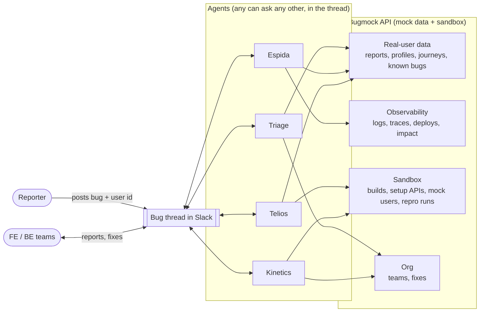
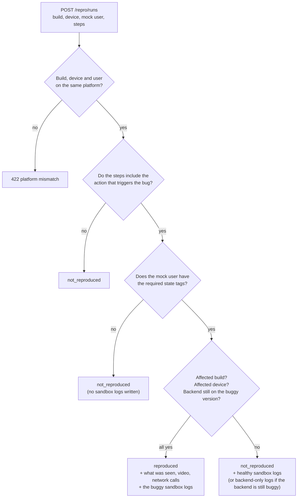
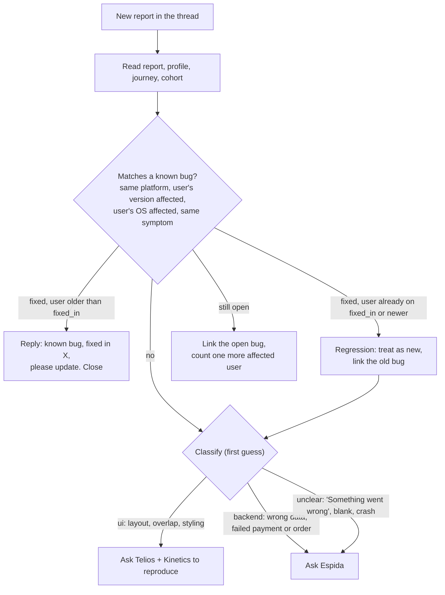
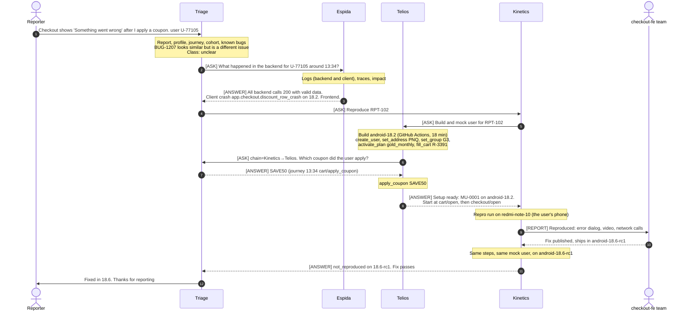
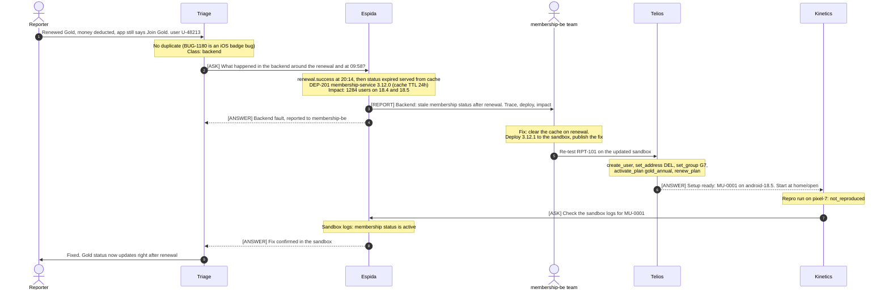
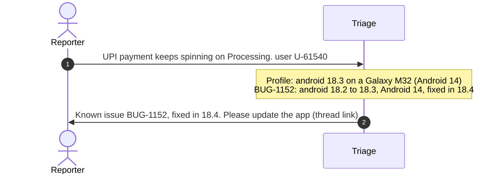

# Bug agents: how the system works

People report app bugs in a Slack channel. A small team of AI agents picks each report up and works out:
- whether it is a known bug
- who the affected user is
- whether the bug is in the backend, the frontend, or both

When the bug is new, the agents reproduce it with a mock copy of the user and hand clear evidence to the
team that owns the fix. Once the fix exists, they check it.

This document explains:

1. [The agents](#1-the-agents): what each one does and doesn't do
2. [The big picture](#2-the-big-picture)
3. [The mock data they work with](#3-the-mock-data)
4. [How they talk to each other](#4-how-the-agents-talk)
5. [Each agent's prompt](#5-each-agents-prompt)
6. [How they reach a conclusion](#6-how-they-reach-a-conclusion)
7. [The flows, step by step](#7-the-flows-step-by-step), with sequence diagrams
8. [Running the demo](#8-running-the-demo)

> Everything here is a demo. The users, logs, builds and bugs are hand-written mock data served by
> **Bugmock**, a small API in this repo. No real user data is involved.

---

## 1. The agents

There is **no fixed pipeline and no central coordinator**. Each agent owns one area. Any agent can
ask any other agent a question, and the agent that's asked answers only from its own area. The order
of work emerges from those questions.

| Agent | One-line job | Owns | Never does |
|---|---|---|---|
| **Triage** | Front door and owner of every bug | The bug and its Slack thread, the reporter, duplicate checks, the real user's profile and journey, the first classification | Reproduce, read logs in depth, fix |
| **Telios** | Prepares reproductions | Mock users and their data in a sandbox, login credentials, the right app build for a version | Reproduce or test anything, or touch real users |
| **Kinetics** | Drives the app | Installing a build, logging in as a mock user, following steps, recording what happened, and re-checking frontend fixes | Create data (it asks Telios) or fix code |
| **Espida** | Reads the system's logs | Backend and client logs (prod and sandbox), traces, deploys, error impact | Change anything, or post personal data |
| **FE / BE teams** | People who fix bugs | The code, publishing a fix, deploying backend fixes to the sandbox | — |

A simple way to remember the split:
- **Triage** knows *who the user is and what they did*.
- **Espida** knows *what the system did*.
- **Telios** builds *a copy of the user's situation*.
- **Kinetics** *acts it out*.

---

## 2. The big picture



The **bug thread** is the shared record. Every question, answer, claim and report is posted there,
so any agent can read what's already known before asking. The **Bugmock API** is the agents' window
onto the "world": the real user, the logs, and a sandbox where Telios and Kinetics can safely play
the bug out.

---

## 3. The mock data

All data lives in JSON files under `data/`. `shared.json` holds what every scenario uses, and there is
one file per scenario in `data/scenarios/`. The API serves it read-only. The only thing that changes
while the demo runs is the **sandbox**: mock users, sandbox service versions, sandbox logs, and which
fixes are published. The sandbox lives in memory and resets on restart.

### 3.1 What exists, and who reads it

| Data | What it holds | Endpoint | Read by |
|---|---|---|---|
| Reports | The Slack message: text, user id, time, attachments | `GET /reports/{report_id}` | Triage |
| Known bugs | The bug database: status, affected platforms, versions and OS, `fixed_in`, thread link, error signature | `GET /known-bugs` | Triage |
| User profiles | Platform, app version, device, city, area, group, plan, cohort | `GET /users/{user_id}` | Everyone |
| Journeys | What the user did, in order (screen, action, params such as restaurant, items, coupon, order) | `GET /users/{user_id}/journey` | Everyone |
| Cohorts | The user's combination, `platform-version-city-group-plan`, with labels | `GET /cohorts/{cohort_id}` | Triage, Telios |
| Logs | Backend and client log lines (prod, and sandbox runs), with trace ids, status, error signatures and response excerpts | `GET /logs` | Espida |
| Traces | All log lines for one request, across services | `GET /traces/{trace_id}` | Espida |
| Deploys | Prod deploys: service, version, time, what changed | `GET /deploys` | Espida |
| Impact | How many users hit an error signature, by app version | `GET /impact/{error_signature}` | Espida |
| Builds | Every app build: source (S3, Play, or GitHub Actions from a version branch), download URL, minutes to be ready | `GET /builds/{build_id}` | Telios, Kinetics |
| Devices | Phones to run on: model, OS version, screen size | `GET /devices` | Kinetics, Triage |
| Setup APIs | The catalog Telios plans with: params, prerequisites (`requires`), tags added | `GET /setup-apis` | Telios |
| Mock users | Users Telios creates in the sandbox: login, state tags, calls made | `POST /sandbox/users`, `GET /sandbox/users/{mock_user_id}` | Telios, Kinetics |
| Repro runs | The result of Kinetics running a build on a device with a mock user | `POST /repro/runs` | Kinetics |
| Teams | Who owns which service or screen, and their channel | `GET /teams` | Triage, Espida, Kinetics |
| Fixes | PR, owning team, where it ships. Only visible once **published** | `GET /fixes` | Triage, Kinetics |

### 3.2 The user's "combination" (cohort)

Every user belongs to one combination of five dimensions:

| Dimension | Values |
|---|---|
| Platform | android, ios |
| App version | 18.2, 18.3, 18.4, 18.5 (current) |
| City | DEL Delhi NCR, BOM Mumbai, BLR Bengaluru, PNQ Pune, HYD Hyderabad |
| Group (10 categories) | G1 New, G2 Occasional, G3 Regular, G4 Frequent, G5 High spender, G6 Lapsed, G7 Gold loyalist, G8 Corporate, G9 Student, G10 Late-night |
| Plan | none, gold_monthly, gold_annual, gold_trial |

These combine into one cohort id, for example `android-18.5-DEL-G7-gold_annual`. Telios creates the
mock user with exactly this cohort, so the reproduction runs under the same conditions as the real user.

### 3.3 The five scenarios

| ID | Bug as reported | What's really wrong | Class |
|---|---|---|---|
| GOLD-01 | "Renewed Gold, money deducted, app still says Join Gold" | membership-service 3.12.0 caches status for 24h and doesn't clear the cache on renewal | backend |
| CART-02 | "'Something went wrong' at checkout after a coupon" | The app crashes drawing a discount row that has no label. The backend is fine | frontend (reported as unclear) |
| MENU-03 | "Restaurant name overlaps the rating" | A long name breaks the layout on small iPhones only | ui |
| PAY-04 | "UPI payment stuck on Processing" | Known bug BUG-1152, already fixed in 18.4. The user is on 18.3 | duplicate |
| TRACK-05 | "Track order screen is blank" | A backend deploy changed the ETA format, and app versions 18.2–18.3 can't read it | both (contract mismatch) |

Each scenario also contains **distractors**, so the agents have to reason rather than pattern-match:
a similar-but-different known bug, an unrelated 404 or slow call in the logs, and an unrelated deploy.

### 3.4 The sandbox and how a repro run is decided

Telios builds a mock user with **setup APIs**. Each call adds **tags** describing the user's state,
and each call can require tags from earlier calls:

| Setup API | Requires | Adds |
|---|---|---|
| `POST /sandbox/users` (`create_user`) | — | `user`, `cohort:<id>` |
| `set_address` | user | `address:<city>` |
| `set_group` | user | `group:<group>` |
| `activate_plan` | address | `plan:<plan>`, `plan_status:active` |
| `renew_plan` | plan | `gold_renewed` |
| `add_payment_method` | user | `payment_method:<type>` |
| `fill_cart` | address | `cart`, `cart_restaurant:<id>` |
| `apply_coupon` | cart | `coupon:<code>` |
| `place_order` | address, payment_method | `order:active` |

Calling them in the wrong order returns **409**, with a message naming the call to make first. A value
outside the known lists (city, group, plan, payment type) returns **422**.

When Kinetics posts a repro run, Bugmock checks the scenario's hidden **repro rule**. The bug
reproduces only if all of these hold:



This is why the details matter. The wrong device, a skipped coupon, or an old build gives
`not_reproduced`, and a backend fix only "passes" once its version is deployed to the sandbox.

### 3.5 What's hidden from the agents

- `/admin/*` holds each scenario's expected answer and its repro rules. It is left out of the API
  docs (`/openapi.json`), and the prompts never mention it.
- **Fixes** are invisible until a team publishes them (`POST /fixes/{fix_id}/publish`). Without
  this, an agent could look the answer up before investigating. PAY-04's old fix is visible from the
  start, because it shipped long ago.

---

## 4. How the agents talk

All conversation happens **in the bug's Slack thread**. Agents never call each other directly. They
post a message addressed to another agent, and that agent replies in the thread. Every message uses
one of five formats:

| Message | Used for | Shape |
|---|---|---|
| `[ASK]` | Asking the owner of some information | `bug=… from=… to=… chain=…`, then `question:` and `why:` |
| `[ANSWER]` | Replying with evidence | `answer:`, `evidence:` (which API call or record), `confidence:` high, medium or low |
| `[NOT MINE]` | "That's not my area, ask X" | `try=<agent who owns it>` |
| `[CLAIM]` | "I'm starting on this", so two agents don't duplicate work | `doing: …` |
| `[REPORT]` | A result for a team or the thread | `summary:`, `evidence:`, `next:` |

Example exchange: Telios needs a coupon code that only the real user's journey contains.

```
[ASK] bug=RPT-102 from=Telios to=Triage chain=Kinetics>Telios
question: Which coupon did the user apply before the error?
why: needed to set up the mock user's cart

[ANSWER] bug=RPT-102 from=Triage to=Telios
answer: SAVE50
evidence: journey of U-77105, event 13:34 cart/apply_coupon
confidence: high
```

### Rules every agent follows

1. **Read the thread first.** The answer may already be there.
2. **Ask the owner.** Use the table in [section 1](#1-the-agents). Answer only from your own area.
3. **Carry the chain.** When a question is passed on, add yourself to `chain`. Never ask an agent already in the chain, and stop after **3 hops** with "unknown".
4. **Claim before working**, with `[CLAIM]`.
5. **Budget:** about 15 questions per bug in total, and at most 3 repro runs. When the budget runs out, report what is known to the owning team.
6. **Cite evidence:** every fact names the API call, log id, trace id or run id it came from.

**Triage owns each bug from start to finish.** It is the only agent that talks to the reporter, it
posts status updates, it nudges whoever claimed a step if the bug goes quiet, and it closes the bug.
It does **not** decide who asks whom.

---

## 5. Each agent's prompt

The full, ready-to-paste system prompts are in `prompts/`. Those files are the exact text: paste one
into the agent's system prompt and give the agent an HTTP tool. All four share the same structure:

1. **Role**: what the agent owns, and what it must never do
2. **Team directory**: who owns what, and what to ask each agent
3. **Tools**: the live base URL, then every endpoint the agent uses, with path params, query params, JSON body, allowed values, what comes back, and an example
4. **Playbook**: how the agent works through a bug (this is guidance, not a fixed script)
5. **Shared protocol**: the message formats and rules from [section 4](#4-how-the-agents-talk)

The prompt examples use made-up values (`U-12345`, `R-1000`, coupon `WELCOME20`), never real scenario
ids, so the prompts can't leak answers. A test (`tests/test_prompts.py`) enforces this, along with three
other checks: every endpoint a prompt names exists, no prompt mentions `/admin`, and every prompt names
the other agents.

| Agent | Prompt file | Endpoints it's given | The heart of its instructions |
|---|---|---|---|
| Triage | [`prompts/triage.md`](../prompts/triage.md) | reports, known bugs, users, journeys, cohorts, devices, fixes, teams | Check duplicates (with a version-aware rule), classify, route, answer questions about the real user, close the bug |
| Telios | [`prompts/telios.md`](../prompts/telios.md) | builds, setup APIs, sandbox users and setup calls, sandbox services, users, journeys, cohorts | Collect the target state, fetch the build first, plan setup calls by their prerequisites, stop just before the buggy step, hand over |
| Kinetics | [`prompts/kinetics.md`](../prompts/kinetics.md) | devices, builds, sandbox users, repro runs, fixes, users, journeys | Match the real user's build, device and steps, run, change one thing at a time (max 3 runs), read network calls, report |
| Espida | [`prompts/espida.md`](../prompts/espida.md) | logs, traces, deploys, impact, teams, sandbox services, users, journeys | Choose the time window from the journey, follow traces, check deploys and impact, apply the layer rules, report with ids |

---

## 6. How they reach a conclusion

No single agent decides everything. Each one draws a conclusion inside its own area, backed by
evidence, and the bug's outcome comes from those conclusions together.

### 6.1 Triage: is it new, and what kind of bug is it?



Triage's classification is only a starting point. Espida's evidence or Kinetics's result can
overturn it. In CART-02, for example, the bug looks "unclear" and turns out to be frontend.

### 6.2 Espida: which layer is at fault?

Espida takes the time window from the journey (30 minutes before the first error to 10 minutes after),
pulls the user's backend and client logs, follows every trace with a warning or error, and checks
deploys and impact. Then it applies these rules:

| What the logs show | Verdict | Next |
|---|---|---|
| A backend call failed (4xx/5xx), timed out, or returned wrong or stale data, often right after a deploy | **backend** | Report to the team that owns the service |
| Every backend call returned 200 with valid data, but the client logged an error | **frontend** | Kinetics reproduces; report to the team that owns the screen |
| A deploy changed a response's shape, and the client errors only on **older app versions** (the impact split shows it) | **both**: a contract mismatch; name the side that broke it | Report to the backend team (old apps can't be patched); tell the frontend team |
| Nothing wrong at all | **logs clean**, likely UI-only | Kinetics reproduces |

Unrelated noise, such as a 404 promo banner or a slow menu call, is ignored unless it lines up with
the error.

### 6.3 Telios: what to set up, in what order

1. **Target state.** From the profile and journey, list everything that must be true for the bug to
   happen: city and area, group, plan (and renewal), payment method, cart, coupon, active order.
   Anything missing goes to Triage as an `[ASK]`.
2. **Build first**, because it can take longest: `GET /builds/<platform>-<app_version>`.
3. **Plan the calls** so every `requires` is met by an earlier call's tags, starting with the user's
   exact cohort.
4. **Stop before the bug.** Telios sets up the state; the steps that trigger the bug are left for
   Kinetics to do in the app. For example, Telios applies the coupon, and Kinetics opens checkout.
5. **A 409 is information.** Add the missing call and carry on, without working around it.

### 6.4 Kinetics: did it reproduce?

- Match the real user exactly: their **build** (`platform-app_version`), their **device** (screen size
  and OS matter), and the **steps** from their journey.
- If the result is `not_reproduced`, change **one** thing at a time, up to 3 runs: missing step, wrong
  device or build, or missing state (ask Telios).
- Read the run's network calls. If a call looks wrong, ask Espida.
- "Not reproduced, here is everything I tried" is a valid, useful result.

### 6.5 When is a bug done?

| Fix type | How it's checked | It passes when |
|---|---|---|
| Frontend | The team publishes the fix. Kinetics re-runs the **same steps** with the **same mock user** on the fixed build (`ships_in`) | `not_reproduced` |
| Backend | The team deploys the fix to the sandbox. Telios sets up the mock user, Kinetics re-runs on the user's **original** build, and Espida reads the sandbox logs | `not_reproduced`, and the call that used to fail now returns correct data |

Triage then tells the reporter what was fixed and where it ships, and closes the bug.

---

## 7. The flows, step by step

### 7.1 CART-02: looks unclear, turns out frontend (the most cross-talk)



### 7.2 GOLD-01: backend bug, checked in the sandbox



### 7.3 PAY-04: a duplicate, settled by Triage alone



If an agent investigates anyway, the data agrees with that answer:
- Espida finds the same error signature.
- Kinetics reproduces on 18.3 on an Android 14 phone.
- Kinetics doesn't reproduce on 18.4, or on an Android 12 phone.

### 7.4 MENU-03 and TRACK-05 in brief

**MENU-03 (ui).** Triage classifies it as ui and asks for a reproduction. Telios fetches `ios-18.5`
and sets up a new Bengaluru user. Kinetics opens the long-named restaurant:
- On an iPhone 15 it does **not** reproduce. Kinetics asks Triage for the user's device, which is an iPhone SE.
- On the SE it reproduces.

Espida, if asked, finds only 200s. After the fix, the iOS 18.6 release candidate no longer reproduces.

**TRACK-05 (both).** Espida finds:
- the tracking call returning 200 with the new ETA format (schema v2)
- a client `TypeError` on 18.3
- deploy DEP-205 that morning
- impact only on app versions 18.2–18.3

Its verdict: the backend broke the contract for old apps. The backend team serves the old format to
apps below 18.4 (5.3.1), and the frontend team is informed. Kinetics's clue before the fix: the same
steps on 18.4 don't reproduce, because newer apps cope. After 5.3.1 is in the sandbox, 18.3 no
longer reproduces, and Espida sees `schema_version: 1` in the sandbox logs.

---

## 8. Running the demo

1. **Start the API with a public URL:** `scripts/tunnel.sh`. It prints `BUGMOCK_URL=https://….trycloudflare.com`
   and rewrites that URL into `prompts/*.md`. The URL changes on every restart.
2. **Create the agents.** Paste each `prompts/<agent>.md` as the system prompt, give the agent an HTTP
   tool (or generate tools from `/openapi.json`), and connect the agent to the bug channel.
3. **Play the reporter.** Post a report's text in the channel, e.g. the text of `GET /reports/RPT-102`.
4. **Play the teams** when the agents report to you:
   - Frontend fix: `POST /fixes/<fix_id>/publish`, then tell Kinetics which build to check (`ships_in`).
   - Backend fix: `POST /sandbox/deploy` with `{"service": "...", "version": "..."}`, then `POST /fixes/<fix_id>/publish`.
5. **Check the agents' work** against `GET /admin/scenarios/<id>`, which has the expected class and path.
6. **Reset between runs:** `POST /sandbox/reset`. It clears mock users, sandbox logs, deploys and published fixes.

| Scenario | Report | Fix id | How the team "fixes" it |
|---|---|---|---|
| GOLD-01 | RPT-101 | FIX-GOLD-01 | deploy `membership-service` `3.12.1`, then publish |
| CART-02 | RPT-102 | FIX-CART-02 | publish (ships in `android-18.6-rc1`) |
| MENU-03 | RPT-103 | FIX-MENU-03 | publish (ships in `ios-18.6-rc1`) |
| PAY-04 | RPT-104 | FIX-PAY-04 | already published (shipped in 18.4) |
| TRACK-05 | RPT-105 | FIX-TRACK-05 | deploy `order-tracking-service` `5.3.1`, then publish |

Limits to keep in mind: the API is open to anyone with the URL, the sandbox is in memory and resets on
restart, and the URL stops working when the laptop sleeps.
