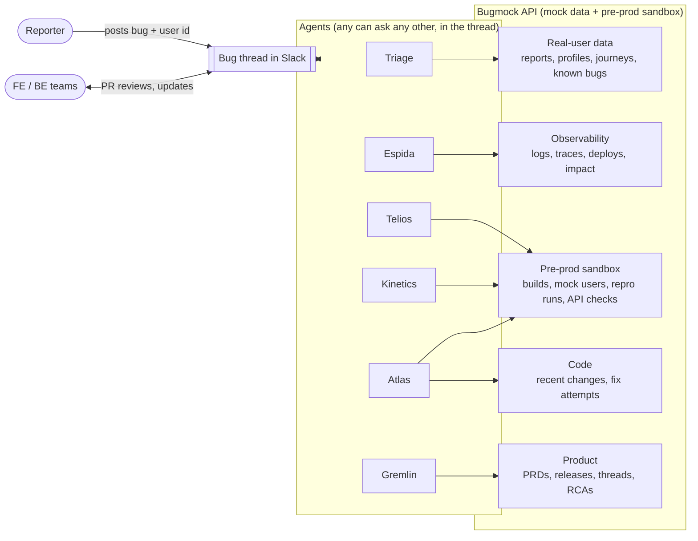
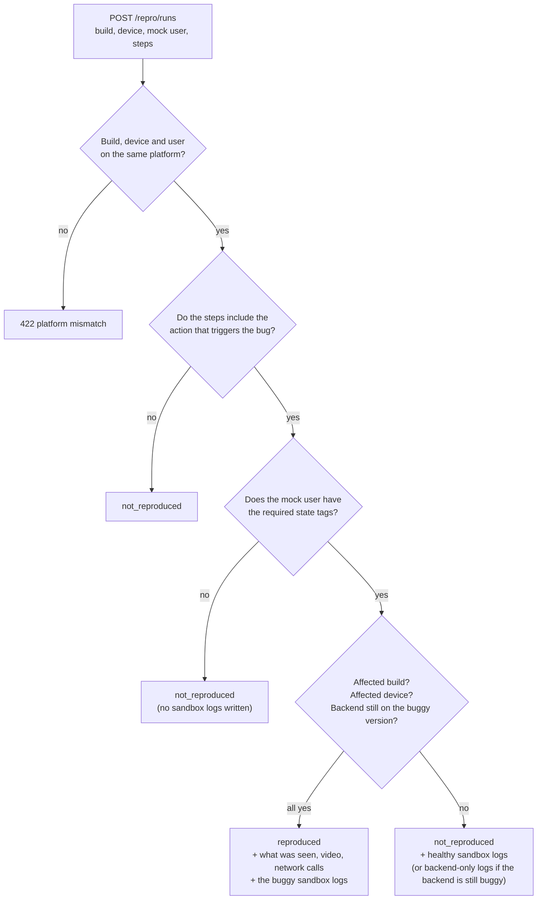
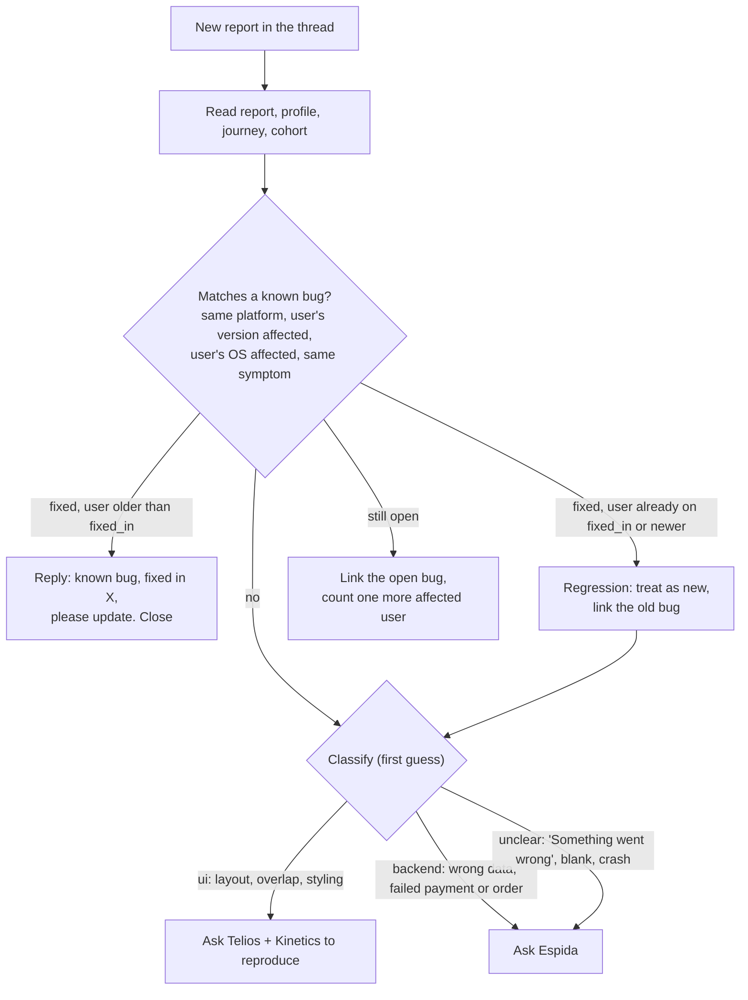
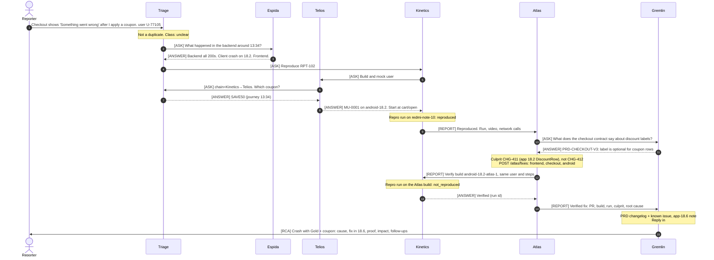
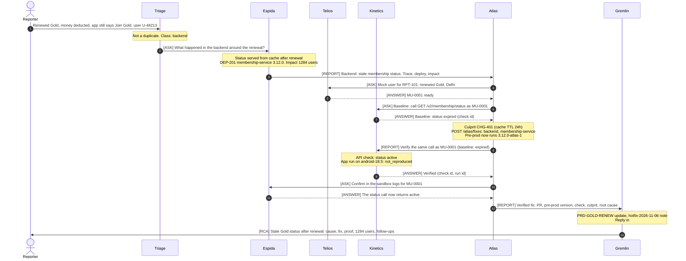
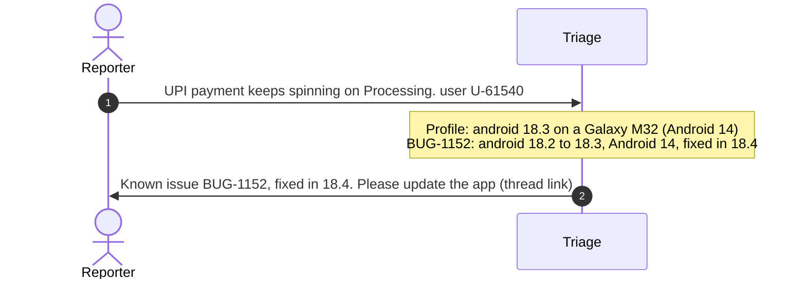

# Bug agents: how the system works

People report app bugs in a Slack channel. A small team of AI agents picks each report up and works out:
- whether it is a known bug
- who the affected user is
- whether the bug is in the backend, the frontend, or both

When the bug is new, the agents reproduce it with a mock copy of the user, **fix it** (PR plus a new
app build or a pre-prod deploy), **verify** the fix, and **close the loop**: they update the PRD and
release notes, tell the teams and related channels, and post a final RCA.

This document explains:

1. [The agents](#1-the-agents): what each one does and doesn't do
2. [The big picture](#2-the-big-picture)
3. [The mock data they work with](#3-the-mock-data)
4. [How they talk to each other](#4-how-the-agents-talk)
5. [Each agent's prompt](#5-each-agents-prompt)
6. [How they reach a conclusion](#6-how-they-reach-a-conclusion)
7. [The flows, step by step](#7-the-flows-step-by-step), with sequence diagrams
8. [Running the demo](#8-running-the-demo)

> Everything here is a demo. The users, logs, builds and bugs are hand-written mock data served by
> **Bugmock**, a small API in this repo. No real user data is involved.

---

## 1. The agents

There is **no fixed pipeline and no central coordinator**. Each agent owns one area. Any agent can
ask any other agent a question, and the agent that's asked answers only from its own area. The order
of work emerges from those questions.

| Agent | One-line job | Owns | Never does |
|---|---|---|---|
| **Triage** | Front door of every bug | The bug and its Slack thread, the reporter, duplicate checks, the real user's profile and journey, the first classification | Reproduce, read logs in depth, fix |
| **Telios** | Prepares reproductions | Mock users and their data in a sandbox, login credentials, the right app build for a version | Reproduce or test anything, or touch real users |
| **Kinetics** | Drives the app and checks fixes | Reproducing in the app; verifying frontend fixes in the app and backend fixes with an API call on pre-prod | Create data (it asks Telios) or fix code |
| **Espida** | Reads the system's logs | Backend and client logs (prod and sandbox), traces, deploys, error impact | Change anything, or post personal data |
| **Atlas** | Owns the fix | Finding the culprit change, opening the PR, shipping a new build (frontend) or a pre-prod deploy (backend) | Merge PRs, touch prod, or claim a fix works before it's verified |
| **Gremlin** | Product and program manager | PRDs, the release calendar, related threads in other channels, informing teams, the final RCA | Investigate, fix or verify |
| **FE / BE teams** | People | Reviewing and merging Atlas's PRs, and owning their features | — |

A simple way to remember the split:
- **Triage** knows *who the user is and what they did*.
- **Espida** knows *what the system did*.
- **Telios** builds *a copy of the user's situation*, and **Kinetics** *acts it out*.
- **Atlas** *changes the code*, and **Gremlin** *tells everyone what changed and why*.

---

## 2. The big picture



The **bug thread** is the shared record. Every question, answer, claim, report and the final RCA is
posted there, so any agent can read what's already known before asking. The **Bugmock API** is the
agents' window onto the "world": the real user, the logs, the code history, the product docs, and a
pre-prod sandbox where fixes are tried and proven.

The loop in one line: **Triage** checks and classifies → **Espida** / **Telios** + **Kinetics**
confirm the bug → **Atlas** fixes it → **Kinetics** verifies → **Gremlin** updates the product side
and posts the RCA.

---

## 3. The mock data

All data lives in JSON files under `data/`. `shared.json` holds what every scenario uses, and there is
one file per scenario in `data/scenarios/`. The API serves it read-only. The only thing that changes
while the demo runs is the **sandbox**: mock users, sandbox service versions, sandbox logs, and which
fixes are published. The sandbox lives in memory and resets on restart.

### 3.1 What exists, and who reads it

| Data | What it holds | Endpoint | Used by |
|---|---|---|---|
| Reports | The Slack message: text, user id, time, attachments | `GET /reports/{report_id}` | Triage |
| Known bugs | The bug database: status, affected platforms, versions and OS, `fixed_in`, thread link, error signature | `GET /known-bugs` | Triage |
| User profiles | Platform, app version, device, city, area, group, plan, cohort | `GET /users/{user_id}` | Everyone |
| Journeys | What the user did, in order (screen, action, params) | `GET /users/{user_id}/journey` | Everyone |
| Cohorts | The user's combination, `platform-version-city-group-plan`, with labels | `GET /cohorts/{cohort_id}` | Triage, Telios |
| Logs, traces | Backend and client log lines (prod, sandbox runs and API checks) | `GET /logs`, `GET /traces/{trace_id}` | Espida |
| Deploys, impact | Prod deploys; users hit per error signature, by app version | `GET /deploys`, `GET /impact/{error_signature}` | Espida |
| Builds | Every app build, plus Atlas's new `-atlas-<n>` builds | `GET /builds/{build_id}` | Telios, Kinetics, Atlas |
| Devices | Phones to run on: model, OS version, screen size | `GET /devices` | Kinetics, Triage |
| Setup APIs, mock users | How Telios builds a mock user, and the users it built | `GET /setup-apis`, `/sandbox/users…` | Telios, Kinetics |
| Repro runs | Kinetics running a build on a device with a mock user | `POST /repro/runs` | Kinetics |
| **API checks** | Kinetics calling a backend endpoint on pre-prod as a mock user | `POST /api-checks` | Kinetics |
| **Recent changes** | Merged PRs per repo and area, with release version (the culprit hides among distractors) | `GET /changes` | Atlas, Gremlin |
| **Fix attempts** | Atlas's fixes: PR, and a new build or a pre-prod version | `POST /atlas/fixes`, `GET /fixes` | Atlas (others read) |
| **PRDs** | Feature docs: sections (including contracts), known issues, changelog | `GET /prds`, `POST /prds/{prd_id}/updates` | Gremlin |
| **Releases** | App releases (18.5 released, 18.6 in QA, 18.7 planned) and the backend hotfix train | `GET /releases`, `POST /releases/{release_id}/notes` | Gremlin |
| **Threads** | Conversations in other channels (support, QA, design, on-call, release) | `GET /threads?q=`, `POST /threads/{thread_id}/replies` | Gremlin |
| **RCAs** | The final write-up per bug | `POST /rca`, `GET /rca/{bug_ref}` | Gremlin |
| Teams | Who owns which service or screen, and their channel | `GET /teams` | Triage, Espida, Atlas, Gremlin |

Atlas's and Gremlin's data per scenario:

| Scenario | Culprit change (distractors exist for each) | PRD | Related threads |
|---|---|---|---|
| GOLD-01 | `CHG-401` membership-service: status cache TTL 24h, invalidation async | `PRD-GOLD-RENEW` | `#gold-support` (members see Join Gold) |
| CART-02 | `CHG-411` app 18.2: new DiscountRow component | `PRD-CHECKOUT-V3` (contract: coupon `label` optional) | `#checkout-v3` (QA saw the crash in October) |
| MENU-03 | `CHG-421` iOS 18.4: name and rating on one row | `PRD-RESTO-HEADER` (designed for 390pt+ screens) | `#design-reviews` (a designer flagged SE names before launch) |
| TRACK-05 | `CHG-431` order-tracking-service: ETA as a range for all clients | `PRD-TRACK-ETA` (old apps only understand v1) | `#logistics-oncall`, `#app-release` |
| PAY-04 | `CHG-441` (the old 18.4 fix) | — | — (a duplicate) |

### 3.2 The user's "combination" (cohort)

Every user belongs to one combination of five dimensions:

| Dimension | Values |
|---|---|
| Platform | android, ios |
| App version | 18.2, 18.3, 18.4, 18.5 (current) |
| City | DEL Delhi NCR, BOM Mumbai, BLR Bengaluru, PNQ Pune, HYD Hyderabad |
| Group (10 categories) | G1 New, G2 Occasional, G3 Regular, G4 Frequent, G5 High spender, G6 Lapsed, G7 Gold loyalist, G8 Corporate, G9 Student, G10 Late-night |
| Plan | none, gold_monthly, gold_annual, gold_trial |

These combine into one cohort id, for example `android-18.5-DEL-G7-gold_annual`. Telios creates the
mock user with exactly this cohort, so the reproduction runs under the same conditions as the real user.

### 3.3 The five scenarios

| ID | Bug as reported | What's really wrong | Class |
|---|---|---|---|
| GOLD-01 | "Renewed Gold, money deducted, app still says Join Gold" | membership-service 3.12.0 caches status for 24h and doesn't clear the cache on renewal | backend |
| CART-02 | "'Something went wrong' at checkout after a coupon" | The app crashes drawing a discount row that has no label. The backend is fine | frontend (reported as unclear) |
| MENU-03 | "Restaurant name overlaps the rating" | A long name breaks the layout on small iPhones only | ui |
| PAY-04 | "UPI payment stuck on Processing" | Known bug BUG-1152, already fixed in 18.4. The user is on 18.3 | duplicate |
| TRACK-05 | "Track order screen is blank" | A backend deploy changed the ETA format, and app versions 18.2–18.3 can't read it | both (contract mismatch) |

Each scenario also contains **distractors**, so the agents have to reason rather than pattern-match:
a similar-but-different known bug, an unrelated 404 or slow call in the logs, and an unrelated deploy.

### 3.4 The sandbox and how a repro run is decided

Telios builds a mock user with **setup APIs**. Each call adds **tags** describing the user's state,
and each call can require tags from earlier calls:

| Setup API | Requires | Adds |
|---|---|---|
| `POST /sandbox/users` (`create_user`) | — | `user`, `cohort:<id>` |
| `set_address` | user | `address:<city>` |
| `set_group` | user | `group:<group>` |
| `activate_plan` | address | `plan:<plan>`, `plan_status:active` |
| `renew_plan` | plan | `gold_renewed` |
| `add_payment_method` | user | `payment_method:<type>` |
| `fill_cart` | address | `cart`, `cart_restaurant:<id>` |
| `apply_coupon` | cart | `coupon:<code>` |
| `place_order` | address, payment_method | `order:active` |

Calling them in the wrong order returns **409**, with a message naming the call to make first. A value
outside the known lists (city, group, plan, payment type) returns **422**.

When Kinetics posts a repro run, Bugmock checks the scenario's hidden **repro rule**. The bug
reproduces only if all of these hold:



This is why the details matter. The wrong device, a skipped coupon, or an old build gives
`not_reproduced`, and a backend fix only "passes" once its version is deployed to the sandbox.

### 3.5 What's hidden from the agents

- `/admin/*` holds each scenario's expected answer and its repro rules.
- **Whether an Atlas fix is right.** A right and a wrong fix get the same kind of response: a PR, plus a `-atlas-<n>` build or version. Only a repro run or an API check shows whether the bug is gone, so Atlas can't find the answer by trial and lookup.
- **Operator-only routes:** `POST /sandbox/deploy`, `POST /fixes/{fix_id}/publish` and `POST /sandbox/reset`. These are for the person running the demo.

All of the above are left out of `/openapi.json`, and no prompt mentions them.

---

## 4. How the agents talk

All conversation happens **in the bug's Slack thread**. Agents never call each other directly. They
post a message addressed to another agent, and that agent replies in the thread. Every message uses
one of six formats:

| Message | Used for | Shape |
|---|---|---|
| `[ASK]` | Asking the owner of some information | `bug=… from=… to=… chain=…`, then `question:` and `why:` |
| `[ANSWER]` | Replying with evidence | `answer:`, `evidence:` (which API call or record), `confidence:` high, medium or low |
| `[NOT MINE]` | "That's not my area, ask X" | `try=<agent who owns it>` |
| `[CLAIM]` | "I'm starting on this", so two agents don't duplicate work | `doing: …` |
| `[REPORT]` | A result for another agent, a team or the thread (e.g. Kinetics → Atlas, Atlas → Gremlin) | `summary:`, `evidence:`, `next:` |
| `[RCA]` | **Gremlin only.** The final write-up, which closes the bug | `what_happened:`, `root_cause:`, `fix:`, `verification:`, `impact:`, `follow_ups:` |

**Ready for temporary channels.** Every header can carry `channel=<channel>`. In the future, a bug's
discussion can move to a temporary channel. Gremlin then posts the `[RCA]` there **and** back in the
original bug thread. Nothing creates or moves channels yet.

Example exchange: Telios needs a coupon code that only the real user's journey contains.

```
[ASK] bug=RPT-102 from=Telios to=Triage chain=Kinetics→Telios
question: Which coupon did the user apply before the error?
why: needed to set up the mock user's cart

[ANSWER] bug=RPT-102 from=Triage to=Telios
answer: SAVE50
evidence: journey of U-77105, event 13:34 cart/apply_coupon
confidence: high
```

### Rules every agent follows

1. **Read the thread first.** The answer may already be there.
2. **Ask the owner.** Use the table in [section 1](#1-the-agents). Answer only from your own area.
3. **Carry the chain.** When a question is passed on, add yourself to `chain`. Never ask an agent already in the chain, and stop after **3 hops** with "unknown".
4. **Claim before working**, with `[CLAIM]`.
5. **Budget:** about 15 questions per bug in total, at most 3 repro runs, and at most **2 fix attempts** by Atlas before it escalates to the owning team.
6. **Cite evidence:** every fact names the API call, log id, trace id, run id or check id it came from.

**Who closes a bug?** Gremlin's `[RCA]` closes every bug that was fixed. Triage closes duplicates
itself. Triage stays the reporter's contact throughout.

---

## 5. Each agent's prompt

The full, ready-to-paste system prompts are in `prompts/`. Those files are the exact text: paste one
into the agent's system prompt and give the agent an HTTP tool. All six share the same structure:

1. **Role**: what the agent owns, and what it must never do
2. **Team directory**: who owns what, and what to ask each agent
3. **Tools**: the live base URL, then every endpoint the agent uses, with path params, query params, JSON body, allowed values, what comes back, and an example
4. **Playbook**: how the agent works through a bug (this is guidance, not a fixed script)
5. **Shared protocol**: the message formats and rules from [section 4](#4-how-the-agents-talk)

Examples in the prompts use made-up values, never scenario ids, so the prompts can't leak answers.
`tests/test_prompts.py` enforces this. It also checks that, in every prompt:
- every endpoint named exists
- no hidden route is mentioned
- the other agents are named
- the base URL is present
- the protocol includes `channel=` and `[RCA]`

| Agent | Prompt file | Endpoints it's given | The heart of its instructions |
|---|---|---|---|
| Triage | [`prompts/triage.md`](../prompts/triage.md) | reports, known bugs, users, journeys, cohorts, devices, fixes, teams | Check duplicates (with a version-aware rule), classify, route, answer questions about the real user, close duplicates |
| Telios | [`prompts/telios.md`](../prompts/telios.md) | builds, setup APIs, sandbox users and setup calls, sandbox services, users, journeys, cohorts | Collect the target state, fetch the build first, plan setup calls by their prerequisites, stop just before the buggy step, hand over |
| Kinetics | [`prompts/kinetics.md`](../prompts/kinetics.md) | devices, builds, sandbox users, repro runs, **API checks**, fixes, users, journeys | Reproduce like the real user and report to Atlas; verify frontend fixes in the app and backend fixes with `POST /api-checks`; answer Atlas |
| Espida | [`prompts/espida.md`](../prompts/espida.md) | logs, traces, deploys, impact, teams, sandbox services, users, journeys | Choose the time window from the journey, follow traces, check deploys and impact, apply the layer rules, report to Atlas, and confirm backend fixes from the sandbox logs |
| **Atlas** | [`prompts/atlas.md`](../prompts/atlas.md) | changes, atlas fixes, fixes, sandbox services, builds, traces, reports, users, teams | Find the culprit among recent changes, decide the layer (asking Gremlin for the intended behaviour), submit the fix, hand it to Kinetics, retry at most once, hand the verified fix to Gremlin |
| **Gremlin** | [`prompts/gremlin.md`](../prompts/gremlin.md) | PRDs (+updates), releases (+notes), threads (+replies), RCA, teams, fixes, changes, impact | Answer product questions during a bug; after verification, update the PRD and release, reply in related threads, inform the teams, write and post the `[RCA]` |

---

## 6. How they reach a conclusion

No single agent decides everything. Each one draws a conclusion inside its own area, backed by
evidence, and the bug's outcome comes from those conclusions together.

### 6.1 Triage: is it new, and what kind of bug is it?



Triage's classification is only a starting point. Espida's evidence or Kinetics's result can
overturn it. In CART-02, for example, the bug looks "unclear" and turns out to be frontend.

### 6.2 Espida: which layer is at fault?

Espida takes the time window from the journey (30 minutes before the first error to 10 minutes after),
pulls the user's backend and client logs, follows every trace with a warning or error, and checks
deploys and impact. Then it applies these rules:

| What the logs show | Verdict | Next |
|---|---|---|
| A backend call failed (4xx/5xx), timed out, or returned wrong or stale data, often right after a deploy | **backend** | Report to the team that owns the service |
| Every backend call returned 200 with valid data, but the client logged an error | **frontend** | Kinetics reproduces; report to the team that owns the screen |
| A deploy changed a response's shape, and the client errors only on **older app versions** (the impact split shows it) | **both**: a contract mismatch; name the side that broke it | Report to the backend team (old apps can't be patched); tell the frontend team |
| Nothing wrong at all | **logs clean**, likely UI-only | Kinetics reproduces |

Unrelated noise, such as a 404 promo banner or a slow menu call, is ignored unless it lines up with
the error.

### 6.3 Telios: what to set up, in what order

1. **Target state.** From the profile and journey, list everything that must be true for the bug to
   happen: city and area, group, plan (and renewal), payment method, cart, coupon, active order.
   Anything missing goes to Triage as an `[ASK]`.
2. **Build first**, because it can take longest: `GET /builds/<platform>-<app_version>`.
3. **Plan the calls** so every `requires` is met by an earlier call's tags, starting with the user's
   exact cohort.
4. **Stop before the bug.** Telios sets up the state; the steps that trigger the bug are left for
   Kinetics to do in the app. For example, Telios applies the coupon, and Kinetics opens checkout.
5. **A 409 is information.** Add the missing call and carry on, without working around it.

### 6.4 Kinetics: did it reproduce?

- Match the real user exactly: their **build** (`platform-app_version`), their **device** (screen size
  and OS matter), and the **steps** from their journey.
- If the result is `not_reproduced`, change **one** thing at a time, up to 3 runs: missing step, wrong
  device or build, or missing state (ask Telios).
- Read the run's network calls. If a call looks wrong, ask Espida.
- "Not reproduced, here is everything I tried" is a valid, useful result.

### 6.5 Atlas: which change, which layer?

1. **Read the evidence:** Kinetics's repro (observed, network calls) and Espida's findings (failing call, deploy, impact).
2. **Find the culprit** with `GET /changes` for the suspect app screen *and* the service behind it. For app changes, look at those released in or before the reporter's app version, since app bugs often ship weeks before anyone reports them. For service changes, look at those deployed shortly before the first error. Each scenario hides the real culprit among plausible distractors (same area, wrong cause).
3. **Decide the layer** against the intended behaviour, which Gremlin quotes from the PRD:
   - **Backend:** the service broke its contract, returns wrong or stale data, or changed a response that already released app versions depend on (old apps can't be patched).
   - **Frontend:** the service behaves as the contract says, and the app mishandles it, or the layout is wrong.
4. **Check for a baseline, then submit.** Kinetics must already have seen the bug with the mock user it will verify with. Then Atlas submits with `POST /atlas/fixes` and hands the fix to Kinetics. Atlas doesn't learn whether it's right until Kinetics verifies. After two failed attempts, it escalates to the owning team.

### 6.6 Kinetics: is the fix real?

| Fix type | How Kinetics checks it | It passes when |
|---|---|---|
| Frontend | Runs the **same steps** with the **same mock user** and device on Atlas's build (`<platform>-<version>-atlas-<n>`) | `not_reproduced` |
| Backend | Calls the endpoint that used to fail with `POST /api-checks` as the mock user, then runs the app once on the user's **original** build. Espida confirms from the sandbox logs | The API response is correct (e.g. `status: active`, `schema_version: 1`), and the app run is `not_reproduced` |

A wrong fix looks exactly like a right one until this step: the bug still reproduces, or the API
still returns the buggy response.

Verification needs a **baseline**: the same mock user must have shown the bug before the fix (a
`reproduced` run, or the buggy API response). Without one, Kinetics answers `inconclusive`, because a
user who never had the bug would look "fixed" whatever Atlas did.

### 6.7 Gremlin: closing the loop

Once Atlas hands over a **verified** fix, Gremlin:

1. **Updates the PRD** with a changelog entry, plus a known issue if users must update the app or old versions stay affected.
2. **Notes the release:** the next open app release (18.6, in QA until 10 Nov) for frontend fixes, or the backend hotfix train.
3. **Searches other channels** (`GET /threads?q=` with the symptom words) and replies in the threads that are really about this issue, such as support, QA, design review or on-call.
4. **Informs the owning team(s)**: the app team for UI or app fixes, and both sides for contract issues.
5. **Writes the RCA** with `POST /rca` and posts the `[RCA]` message, which closes the bug: what users saw, why, what changed, how it was proven, the impact and follow-ups.

---

## 7. The flows, step by step

### 7.1 CART-02: a frontend fix, end to end



### 7.2 GOLD-01: a backend fix, verified with an API call



### 7.3 PAY-04: a duplicate, settled by Triage alone



If an agent investigates anyway, the data agrees with that answer:
- Espida finds the same error signature.
- Kinetics reproduces on 18.3 on an Android 14 phone.
- Kinetics doesn't reproduce on 18.4, or on an Android 12 phone.

### 7.4 MENU-03 and TRACK-05 in brief

**MENU-03 (ui).**
- Telios fetches `ios-18.5`. Kinetics reproduces only on the iPhone SE (it asks Triage for the device).
- Atlas finds `CHG-421`, the iOS 18.4 header change, and ships `ios-18.5-atlas-<n>` targeting the `restaurant` screen. Kinetics re-runs on the SE: fixed.
- Gremlin updates `PRD-RESTO-HEADER` (designed for 390pt+ screens), notes the fix on `app-18.6`, replies in `#design-reviews` (where a designer had raised exactly this), and posts the RCA.

**TRACK-05 (both).**
- Espida finds:
  - the tracking call returning schema v2
  - a client `TypeError` on 18.3
  - deploy DEP-205
  - impact only on 18.2–18.3
- Atlas finds `CHG-431`. Since old apps can't be patched, the fix is **backend**: order-tracking-service serves v1 to apps below 18.4. A first attempt at an app fix would still reproduce on the reporter's 18.3 build, so verification catches it.
- Kinetics's API check on `GET /orders/active/track` now returns `schema_version: 1`.
- Gremlin updates `PRD-TRACK-ETA`, notes the hotfix train, replies in `#logistics-oncall` and `#app-release` (the force-update discussion), informs logistics-be and orders-fe, and posts the RCA.

---

## 8. Running the demo

1. **Start the API with a public URL:** `scripts/tunnel.sh`. It prints `BUGMOCK_URL=https://….trycloudflare.com`
   and rewrites that URL into all six `prompts/*.md`. The URL changes on every restart.
2. **Create the agents.** Paste each `prompts/<agent>.md` as the system prompt, give the agent an HTTP
   tool (or generate tools from `/openapi.json`), and connect the agent to the bug channel.
3. **Play the reporter.** Post a report's text in the channel, e.g. the text of `GET /reports/RPT-102`.
4. **Let the agents run.** They reproduce the bug, fix it, verify the fix and close it with an `[RCA]`.
   The operator no longer deploys or publishes fixes for new bugs.
5. **Check their work:**
   - `GET /admin/scenarios/<id>` has the expected class and path.
   - `GET /rca/<report_id>`, `GET /prds/<id>` and `GET /threads/<id>` show what Gremlin wrote.
   - `GET /fixes?bug_ref=<report_id>` shows Atlas's attempts.
6. **Reset between runs:** `POST /sandbox/reset` clears mock users, logs, Atlas's builds and deploys, API checks, and Gremlin's writes.

| Scenario | Report | Right fix (layer, target) | Culprit | Verified by |
|---|---|---|---|---|
| GOLD-01 | RPT-101 | backend, `membership-service` | CHG-401 | API check `GET /v2/membership/status` → `active`, and the app run |
| CART-02 | RPT-102 | frontend, `checkout` (android or ios) | CHG-411 | App run on the `-atlas-` build |
| MENU-03 | RPT-103 | frontend, `restaurant` (ios) | CHG-421 | App run on the `-atlas-` build on the iPhone SE |
| PAY-04 | RPT-104 | — (duplicate, closed by Triage) | — | — |
| TRACK-05 | RPT-105 | backend, `order-tracking-service` | CHG-431 | API check `GET /orders/active/track` → `schema_version: 1`, and the app run on 18.3 |

Limits to keep in mind: the API is open to anyone with the URL, the sandbox is in memory and resets on
restart, and the URL stops working when the laptop sleeps.

